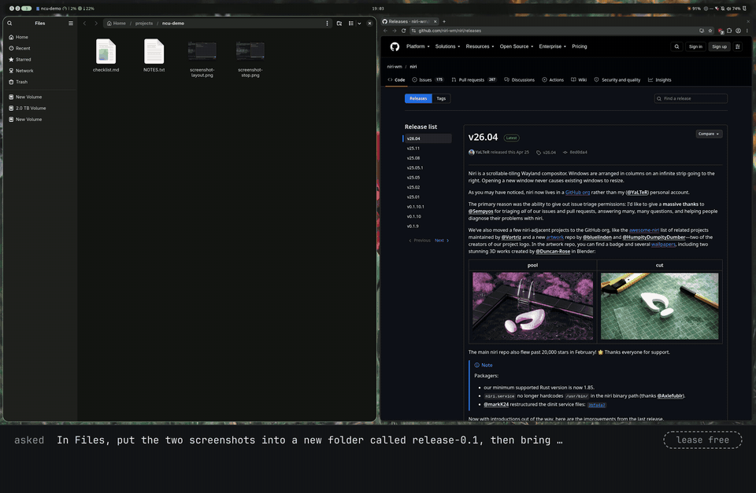

# niri-computer-use

[](https://github.com/ayagmar/niri-computer-use/actions/workflows/ci.yml) [](LICENSE) [](https://github.com/niri-wm/niri)

Let Claude Code, Codex, Pi or any MCP agent see and drive your [niri](https://github.com/niri-wm/niri) desktop: windows, screenshots, buttons by name, keys and clicks, with a stop key you hold.

<picture>
  <source media="(prefers-reduced-motion: reduce)" srcset="site/public/demo/errand.png">
  
</picture>

Asked: "Tell #release the review moved to 3pm, then put me back where I was." A script makes the calls an agent would make, through the real server in a headless nested niri. The band under the desktop summarises each reply with the round trip the harness measured; the chat window is a test stand-in. [The full 17-second recording (MP4)](site/public/demo/errand.mp4).

Documentation: **https://ayagmar.github.io/niri-computer-use/**, also as plain Markdown for agents ([llms.txt](https://ayagmar.github.io/niri-computer-use/llms.txt)).

## What it is

- **Your real desktop, not a VM.** The agent looks at and acts on the screen you are working on.
- **niri only, through niri's own IPC.** Windows, focus and layout come from niri. Where an app exposes its buttons and fields on the accessibility bus, the agent can act on them by name rather than by pixels. With a niri release other than 26.04 the server only looks; a 26.04 patch release works, with a warning in `status`.
- **Guardrails, not a sandbox.** A lease, a stop key, a lock check and an audit log. An agent holding the lease can do anything you could do with a mouse and keyboard.

It offers up to 22 tools over stdio: reading the desktop, screenshots it can save to `~/Pictures/niri-computer-use`, zooming into part of a screenshot to read small text, accessible elements, and, under the lease, focus, launch, close, niri's layout actions, pointer, keyboard, paste, element actions and three Noctalia panels. It is in early development; acceptance evidence for each milestone is in [docs/results/](docs/results/).

## Quickstart

Needs niri 26.04, Rust 1.99.0 through rustup, libxkbcommon, and `grim`, `wtype` and `loginctl` at run time, plus `notify-send` if you turn on `confirm_lease`. From a shell inside your niri session:

```sh
git clone https://github.com/ayagmar/niri-computer-use.git
cargo install --locked --path niri-computer-use
~/.cargo/bin/niri-computer-use status
```

`status` prints a readiness report as JSON; `niri.compat` should be `ok`. Register the server in your agent, here Claude Code, and give your agents the skill that tells them how to use it:

```sh
claude mcp add --scope user niri-computer-use -- ~/.cargo/bin/niri-computer-use serve
cd niri-computer-use
mkdir -p ~/.claude/skills ~/.agents/skills
ln -s "$PWD/skills/niri-computer-use" ~/.claude/skills/niri-computer-use
ln -s "$PWD/skills/niri-computer-use" ~/.agents/skills/niri-computer-use
```

[Client setup](https://ayagmar.github.io/niri-computer-use/start/clients/) covers Codex, Pi and other MCP clients. None needs more than the command: the server finds your niri session itself when its environment lacks one.

Then bind the stop key in your niri config, with the path `cargo install` printed:

```kdl
binds {
    Mod+Shift+Escape allow-inhibiting=false allow-when-locked=true hotkey-overlay-title="Stop the AI agent (niri-computer-use)" { spawn "/home/you/.cargo/bin/niri-computer-use" "stop"; }
}
```

The key cancels the running action and takes the lease back; `niri-computer-use resume` lets agents act again. [First session](https://ayagmar.github.io/niri-computer-use/start/first-session/) walks through the rest.

## Example

Unlike the recording above, here a model chose the calls. This is run `1791814792-1684005` of the following command, with the model `claude-sonnet-5-5` through Claude Code 2.1.296 and the server at `8faae79`, in a headless nested niri:

```sh
make nested-eval SCENARIO=errand SKILL=skills/niri-computer-use MODEL=sonnet
```

The prompt:

> Open my notes app, then type exactly `Meeting moved to 3pm` into the wev window and press Enter once to send it, then close the notes window you opened, and leave me on the window I was on.

The agent's eight calls:

```text
status
desktop_state
acquire_desktop
launch            {"preset": "notes"}
focus             {"window_id": 2}
type_text         {"text": "Meeting moved to 3pm", "expect": {"window_id": 2}, "submit": true, "screenshot": true}
close_window      {"id": 4}
release_desktop   {"restore_focus": true}
```

What `launch` answered:

```json
{
  "accepted": true,
  "observed": "one",
  "windows": [4],
  "focused_window": 4,
  "changes": {
    "focus": {"from": 3, "to": 4},
    "opened": [{"app_id": "notes", "id": 4, "title": "harness window", "workspace_id": 1}]
  }
}
```

`accepted` says niri took the request, `observed` what niri saw afterwards, and `changes` what niri saw change. The grader passed all nine of its checks, among them one launch, exactly the 20 characters before a single Enter, the notes window closed, and focus back on the user's window. The calls with their results and the grading are in [docs/results/readme-example.md](docs/results/readme-example.md).

## Safety

- One agent at a time holds the lease, and only the lease holder acts. Looking needs no lease.
- With `confirm_lease` on, you allow each lease on a desktop notification before the agent gets it, even when its client approves tool calls without asking you. It is off by default.
- The stop key cancels the running action and takes the lease back. An agent can't press it.
- An action starts only after a read of the lock state at most 250 ms old says unlocked. Locked or unknown refuses it.
- Before typing, the server checks that the window the agent names in `expect` has focus, unless it passes `"none"`. Text goes out in parts of up to 100 characters, with focus and the lock read again before each part. Pointer and keyboard input is refused while an app on your deny list has focus, and element actions on its windows.
- Element actions refuse fields the toolkit marks as password fields. Apps start only from presets you write; `unrestricted` lifts that and allows niri's gated actions such as `Spawn`.
- Calls that reach a tool go to an audit log, without the text typed, the clipboard, window titles or images. It is moved aside at 10 MiB and the three latest old logs are kept, so it stays under about 40 MiB.

What isn't protected: any connected agent sees your screen and window titles, a click can land on a denied window that doesn't have focus, typing and clicking don't check for password fields, a lock that comes after the last read isn't caught, and an agent that can run shell commands can answer the `confirm_lease` notification itself. With the default `wtype` backend, a part that has started typing finishes even if focus moves, you press the stop key or the screen locks. A click or a key can do anything you could do. Read [Safety](https://ayagmar.github.io/niri-computer-use/concepts/safety/#what-isnt-a-boundary) before letting an agent act, and [SECURITY.md](SECURITY.md) to report a problem.

## Limits

- niri 26.04 only. With another major or minor release the server is read-only.
- The pointer tools need one monitor at transform `Normal`. The keyboard, screenshots and the other tools work with any monitors.
- Installed from source; there is no package yet.
- Accessibility varies by toolkit. GTK 4 works; GTK 3 and Qt apps that draw their own title bar give no element boxes, and niri 26.04 gives tiled windows none until they float. Activating an element and setting its text work in both cases.

## Documentation

- [Install](https://ayagmar.github.io/niri-computer-use/start/install/) and [Client setup](https://ayagmar.github.io/niri-computer-use/start/clients/): build, check, and register the server in your agent
- [Safety](https://ayagmar.github.io/niri-computer-use/concepts/safety/): what the server enforces, what it doesn't, and how you take the desktop back
- [Configuration](https://ayagmar.github.io/niri-computer-use/concepts/configuration/): `policy.toml`, launch presets, the deny list, `unrestricted`, `confirm_lease`, the shared engine and tool profiles
- [Tools](https://ayagmar.github.io/niri-computer-use/tools/overview/): every tool, its arguments and results
- [Error reference](https://ayagmar.github.io/niri-computer-use/reference/errors/) and [Troubleshooting](https://ayagmar.github.io/niri-computer-use/reference/troubleshooting/): what each error means and what to do
- [CLI reference](https://ayagmar.github.io/niri-computer-use/reference/cli/): `serve`, `status`, `stop`, `resume`, `recover`
- [For agents](https://ayagmar.github.io/niri-computer-use/reference/agents/): every page as Markdown, `llms.txt`, and the skill at stable URLs

## Development

See [docs/development.md](docs/development.md) and [CONTRIBUTING.md](CONTRIBUTING.md).

## License

MIT. See [LICENSE](LICENSE). Built binaries include [`niri-ipc`](https://crates.io/crates/niri-ipc), which is GPL-3.0-or-later, so a distributed binary follows GPL-3.0 terms.
