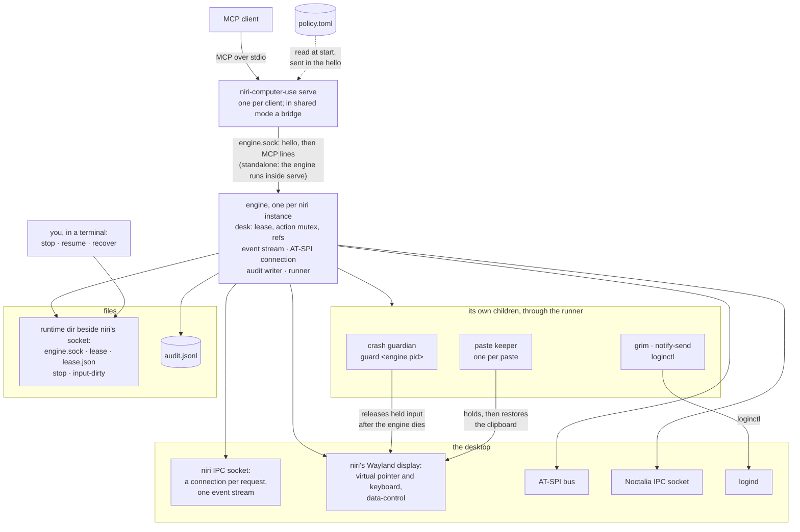
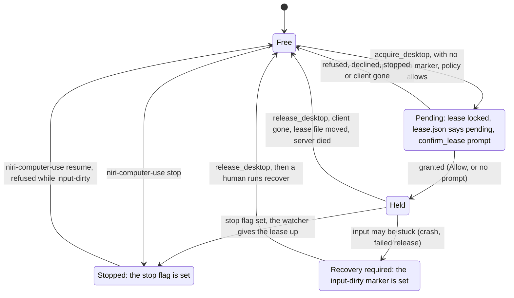
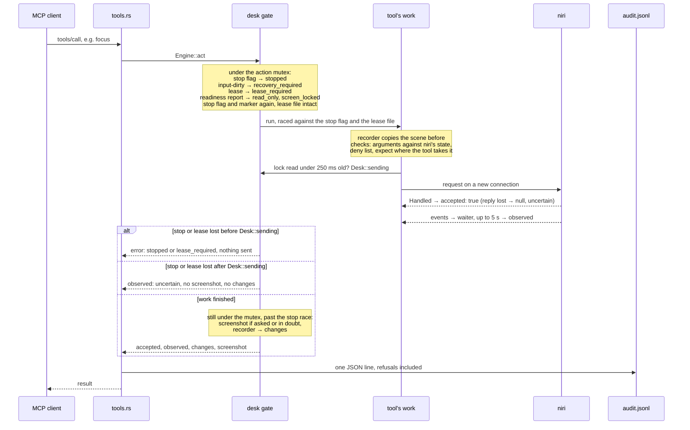
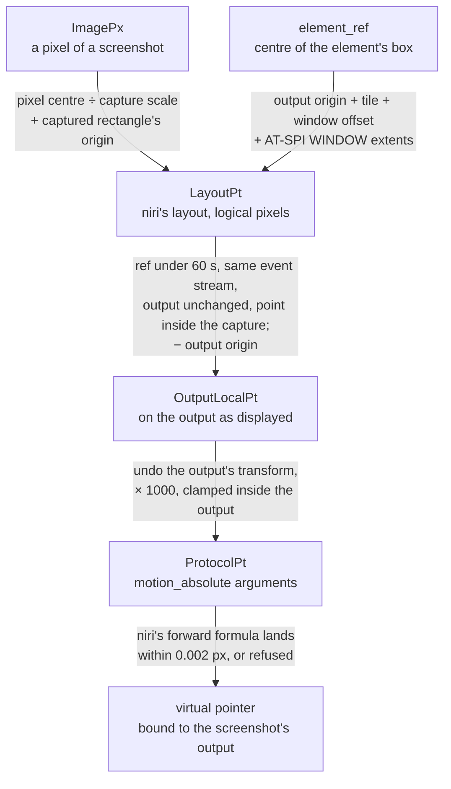

# Architecture

`niri-computer-use` is one binary. `serve` runs an MCP server over stdin and stdout, one process per agent session. `status` prints the readiness report and exits. `stop` and `resume` set and clear the stop flag, and `recover` clears the input-dirty marker. `engine` serves every client of one niri instance from one process, over a Unix socket (see [The shared engine](#the-shared-engine)).

## Processes

Each client starts its own `serve`. In shared mode, the default, `serve` is a bridge to the one engine of its niri instance, and starts that engine when none listens; standalone, it runs an engine of its own. Either way the engine starts the crash guardian before anything else, and a paste keeper for each paste. Every program it runs goes through the runner.

## Modules

| Module | Does |
|---|---|
| `main.rs` | Reads the environment once, with what `discover.rs` finds for the session variables it lacks, picks the subcommand, and starts the server on a single-threaded Tokio runtime. |
| `discover.rs` | Finds `XDG_RUNTIME_DIR`, `NIRI_SOCKET` and `WAYLAND_DISPLAY` when the environment lacks them: parsing niri's socket names and choosing among them are pure, and the reads take their roots as parameters. |
| `tools.rs` | The rmcp tool definitions. Each tool turns the call into one engine or module call and the result into MCP content, and logs it. |
| `engine.rs` | What the server's sessions share, apart from MCP: the crash guardian, the event stream, the accessibility bus, the audit log and the desk, and the work each tool runs through them: the readiness check, the action gate and its evidence, captures and their refs, waits, and giving focus back. |
| `engine/host.rs` | The `engine` subcommand: the engine lock, the instance socket, each connection's hello and session, and the idle exit. `serve_session` serves one session over any stream, stdio included. |
| `engine/hello.rs` | The hello each side sends before MCP on a connection to the engine, and the engine's checks of it (pure, apart from reading the binary's identity). |
| `bridge.rs` | `serve` in shared mode: reaches the instance's engine, starting it under `engine.start.lock` when there is none, then relays the client's MCP lines to it and answers for it when it is lost. |
| `bridge/envelope.rs` | What the bridge reads of a relayed line (request, notification, response) and the answers it makes itself (pure). |
| `session.rs` | One client of the engine: its label in the audit log, the lease record and the lease prompt (`Label`, the client's own name cut to 64 characters of ASCII letters, digits, spaces and `._-+@`, then its PID), and the settings its own environment gives it: the policy file, read from its config directory when the session starts, its `HOME` for `capture_dir`, and its `NIRI_COMPUTER_USE_UNRESTRICTED`, `NIRI_COMPUTER_USE_CONFIRM_LEASE` and `NIRI_COMPUTER_USE_TOOLS`. |
| `niri.rs`, `niri/request.rs`, `niri/events.rs` | The only code that talks to niri: one connection per request, one long-lived event stream, and the virtual pointer's Wayland connection. |
| `niri/pointer.rs` | The virtual pointer: its own Wayland connection to niri, bound to one output. |
| `niri/wayland.rs` | The Wayland transport shared by the virtual devices, the clipboard, the paste keeper and the display check before `grim`: niri's PID must serve the display, and every round trip has a deadline. |
| `niri/selection.rs` | The clipboard through wlr data-control on its own Wayland connection to niri: saving every type of the selection, taking it with a source, the reads of that source, and the selections niri announces. |
| `niri/waiter.rs` | Waiters: how an action watches the event stream, event by event, for its effect. |
| `act.rs` | The action tools' work: check the arguments against niri's state, dispatch one niri action, observe its effect. |
| `niri/version.rs` | The version rule (pure). |
| `policy.rs` | The policy file, its presets, the decision whether this server may take the lease or act, which niri actions `niri_action` sends only with `unrestricted`, which tools each profile lists, which output setups the pointer may run on, and the Noctalia panels `shell_panel` may name (pure, apart from reading the file). |
| `act/compositor.rs` | `niri_action`: any niri action, then the state niri reports for the window it is about. |
| `act/record.rs` | The change report's watch on niri's event stream: a waiter registered as an action's work starts, which afterwards applies every event since and says what changed. |
| `changes.rs` | What an action changed on the desktop, from niri's windows and focused workspace before and after it (pure). |
| `changes/elements.rs` | What an action changed among a window's accessible elements, from a walk before and after it (pure). |
| `act/shell.rs` | `shell_panel`: a panel command, then polling Noctalia's status for the change. `noctalia`: any command, with Noctalia's reply. |
| `status.rs` | Builds the readiness report shared by the tool and the subcommand. |
| `confirm.rs` | The prompt `confirm_lease` shows before a lease is granted: a notification with Deny and Allow through `notify-send`, and what its answer means. |
| `input.rs` | What the input tools share: their context and the focused window's `app_id`. |
| `input/pointer.rs` | The pointer tools' work: the checks before input, the steps of each gesture, and the marker around a button press. |
| `input/keyboard.rs` | `key` and `type_text`: the argument checks, the `expect` check, and what a call reports of the keys that went out. |
| `input/native.rs` | The keyboard: the `expect` check, then one acknowledged key pair at a time, each part of the text with its own keymap, stopping when focus moves. |
| `input/keymap.rs` | Resolves keys and text against the compositor's keymap, and splits text into parts whose missing symbols fit the map's spare keys (pure). |
| `input/paste.rs` | `type_text` with `via: "paste"`: the checks before the clipboard is touched, the keeper's protocol, the key through `input/keyboard.rs`, and the outcome with what became of the clipboard. |
| `input/keeper.rs` | The `paste-keeper` subcommand: saves the selection, holds the text, counts the reads and restores the selection. |
| `input/held.rs` | A pointer gesture's held modifiers with the native keyboard, recorded in the gesture's one input-dirty marker. |
| `settle.rs` | Waits for the screen to stop changing: captures until two in a row are the same image. |
| `wait.rs` | `wait_for`'s work: a window condition on the event stream, an element condition polled with the `elements` walk, or a still screen. |
| `a11y.rs` | The only code that talks to AT-SPI: finds the accessibility bus at startup, then reads one application's tree, every call under a deadline. |
| `a11y/model.rs` | AT-SPI's role and state names, and where an element is in the layout, or why it can't be placed (pure). |
| `a11y/walk.rs` | The bounded walk of one window's accessible tree, over any source of nodes (pure). |
| `elements.rs` | `elements`' work: the window from niri, the deny list, then its app's tree from `a11y.rs`; and the same walk, unfiltered, for an action's element changes. |
| `elements/actions.rs` | `activate_element` and `set_element_text`: the element's window checked in niri, then one AT-SPI call that acts, and what was observed after it. |
| `coords.rs` | The coordinate contract (pure): image pixel to `motion_absolute`, checked against niri's own mapping. |
| `observe.rs` | Screenshots: picks the output, plans grim's arguments and the image size they must produce, and checks the result. |
| `refs.rs` | Screenshot refs and element refs: what each screenshot captured, and each element `elements` listed, kept per lease, and each session's screenshots without the lease, kept for zooming. |
| `save.rs` | Writes a saved screenshot inside the capture directory, refusing symlinks and existing files. |
| `clipboard.rs` | Reads the clipboard's text through data-control, and withholds what its owner marks as a secret. `clipboard/watch.rs` watches the clipboard for one lease, from `acquire_desktop` until the lease is gone, so `clipboard_read` returns only what was copied during it. |
| `noctalia.rs` | The only code that talks to Noctalia: `status`, `panel-open` and `panel-close` over the IPC socket, and with `unrestricted` the `noctalia` tool's commands as given. |
| `control.rs` | The lock state: logind's `LockedHint`, then Noctalia. |
| `control/runtime.rs` | The per-instance runtime directory and its stop flag. |
| `control/stop.rs` | Watches the runtime directory for the stop flag. |
| `control/lease.rs` | The lease lock and the holder record. |
| `control/marker.rs` | Reads and writes the input-dirty marker. |
| `control/recover.rs` | The `recover` subcommand. |
| `control/guard.rs` | The `guard` subcommand, the crash guardian (see [The crash guardian](#the-crash-guardian)). |
| `control/procs.rs` | Process state from `/proc`: whether a process has exited, and its name, arguments and environment. |
| `control/desk.rs` | Whether this server holds the lease: takes it, gives it up, and lets the stop flag take it back. Gates every action and cancels it on a stop or when its session ends. |
| `control/cleanup.rs` | Runs the input cleanups that outlive their call, each within ten seconds of its start, and counts them for the server's wait before it exits. |
| `audit.rs` | The audit log. |
| `runner.rs` | The only code that starts processes. |
| `image_header.rs` | Reads a PNG's or JPEG's size from its header. The harness includes the same file. |
| `error.rs` | Tool failures with their stable names. |
| `cli.rs` | Terminal output for the subcommands. Nothing else may print, because stdout is the MCP transport. |

## The shared engine

`niri-computer-use engine` serves every client of one niri instance from one process, which holds the one desk, crash guardian, event stream, accessibility connection and audit writer. It runs in the instance's runtime directory:

1. It takes an exclusive `flock` on `engine.lock`, waiting up to one second for an engine that is exiting. If another engine keeps it, this one exits 0 having changed nothing.
2. It empties `engine.log`, removes a stale `engine.sock`, binds a new one, sets it to mode `0600` and listens. Only then does it start the crash guardian, the event stream and the accessibility lookup, while connections queue.
3. Each connection must come from a process of the same user (`SO_PEERCRED`); others are closed. The client sends one hello line, at most 512 KiB, within two seconds: the hello version, the identity of the binary it runs (`/proc/self/exe`'s device, inode, size and modification time), the niri socket and Wayland socket it found, its `NIRI_COMPUTER_USE_UNRESTRICTED`, `NIRI_COMPUTER_USE_CONFIRM_LEASE`, and `NIRI_COMPUTER_USE_TOOLS`, its `HOME`, the directories it looks in for `loginctl` and `noctalia`, and its policy file as read (missing, unreadable with the error, or the text). The engine answers `{"engine": {"pid": <pid>}}`, or `{"refused": {"error", "detail"}}` with `engine_version` (another build or hello version), `session_mismatch` (another niri socket or display), `engine_busy` (64 connections already), `bad_hello`, or `no_directory` (it couldn't open the client's working directory, see below), and closes.
4. After the hello the connection carries MCP, and the session's settings come only from its hello. A session ends when its connection ends or fails, or when it sends a line over 16 MiB.
5. Once it has had no connection, no lease held and no input cleanup pending for two seconds, it closes and removes `engine.sock`, still holding the lock, and exits. When its stop watcher ends, because the runtime directory was removed or replaced, it ends every session and exits at once. Either way it removes `engine.sock` only while the path still names the socket it bound: in a replaced directory, it may be a new engine's.

`status` reports under `engine` the serving process's PID, its mode (`standalone` or `shared`), how many sessions it serves and, for a standalone server whose client asked for shared mode, why it fell back. It also reports the process's version, the file `/proc/self/exe` names, whether that path now holds another file or none (`replaced`, as after a reinstall), and its cgroup. The engine's stderr is `engine.log`. Its session ids count up from 1 for its lifetime; a session's ended flag lives with the session, so the engine keeps nothing for a session after its connection is gone.

### The bridge

`serve` runs in shared mode unless `NIRI_COMPUTER_USE_SHARED` is `0`, or it is unset or empty and the policy file says `shared = false`. Any other value of the variable serves the client standalone and says why. It decides once, before it reads anything from its client:

1. It connects to `engine.sock` (500 ms) and sends its hello. If nothing listens there, it creates the runtime directory if it is missing, which it is after someone removed it, takes `engine.start.lock`, so that bridges starting together start one engine, checks the socket again, and starts the engine in its own process group with stderr appended to `engine.log`, then waits up to two seconds for the socket. The first start runs `systemd-run --user --scope --collect --quiet -- /proc/<bridge pid>/exe engine`: `systemd-run` asks the user's systemd manager for a transient scope, moves itself into it and then becomes the engine, so the engine and the guardian it starts don't share the cgroup of the client that started them. When `systemd-run` ends before an engine listens, because it isn't installed, can't reach the manager or the manager refuses, the bridge starts `/proc/self/exe engine --unscoped <reason>` itself at once, with how `systemd-run` exited and what it wrote to `engine.log` as the reason. When neither has happened within the two seconds, the bridge kills `systemd-run` and starts the engine itself the same way, unless `systemd-run` has already become the engine; later starts skip `systemd-run`. `runner::Launcher` owns `systemd-run` until then, so a reconnect dropped because its client left kills it too, with the same exception. The engine reports the reason as `status.engine.unscoped`. When the bridge discovered `XDG_RUNTIME_DIR` rather than inheriting it, `systemd-run` gets it, to find the manager, the engine inherits it from there, and `--runtime-dir-discovered` tells the engine to report it as discovered. It tries at most three starts, retrying every 20 ms to 200 ms, within five seconds.
2. If the engine refuses the hello, the socket's path is too long for a Unix socket (108 bytes), or nothing answers within the five seconds, it serves its client standalone, as without shared mode, and writes why to stderr.
3. Otherwise it relays lines both ways, unchanged. It keeps the ids and methods of the client's requests in flight and the client's `initialize`.

The hello carries the client's `PATH` as the client has it, unset and empty kept apart. On taking the hello, the engine opens the bridge's working directory, which is the client's, through `/proc/<pid>/cwd` with the PID `SO_PEERCRED` gave, and holds it open for the session (`session::Dir`). The runner starts `grim` for a session's calls with that `PATH`, or none when the client has none, in that directory, as `/proc/self/fd/<fd>`, so the system's own search runs as it would for the client's standalone server; `runner::Search` says which `PATH` and directory a child gets. `status.binaries` checks each entry for a file this process may execute, relative ones under the held directory. Renaming or removing the directory's path, or making another directory there, changes nothing for the session, as for a standalone server, whose children inherit its directory. If the engine can't open the directory it refuses the hello with `no_directory`. `loginctl`, for the lock state, and `noctalia` describe the desktop and serve every session, so no client's `PATH` decides them. Every process looks for them once at startup in fixed directories, `/usr/local/bin:/usr/bin:/bin:/run/current-system/sw/bin`, or in the absolute directories `NIRI_COMPUTER_USE_DESKTOP_PATH` names (`runner::Desktop`), and runs `loginctl` by the path it found. `status.desktop_programs` reports the directories and both paths. The directories are read the same way everywhere: absolute ones only, each once, without trailing or repeated slashes, and none whose name isn't UTF-8, so two spellings of one list compare equal. The hello carries the bridge's directories as read, and the engine refuses one that differs with `session_mismatch`, so that client is served standalone with what it found and the engine's other clients keep theirs.

Once relaying, the bridge never serves standalone. When the engine closes the connection, a read from it fails, or a write to it waits five seconds for the engine to read, every request in flight gets `engine_lost`: a `tools/call` as a tool result with `isError`, anything else as a JSON-RPC error. Only calls are limited, to 16 at once, so a client that sends `tools/list` without waiting can have more in flight than the queue to its stdout holds; each of these answers waits for room in that queue, so the writer runs between them. With nothing in flight, the session's next request gets it instead. After that, the next request starts a new connection as in step 1; if that fails, the request gets `engine_unavailable` and the one after tries again. Notifications that arrive with no engine are dropped, and so is a `notifications/cancelled` for a request already answered. On a new connection the bridge replays the client's `initialize`, which can only happen with nothing in flight, takes the first response with the client's own id for it, without passing it on, and sends `notifications/initialized`; then it sends the request.

A client line over 16 MiB ends the bridge: it stops relaying, writes one line to stderr and exits, closing stdout, and the engine ends that session. When the client closes stdin, the bridge closes its side of the connection and passes on what the engine still sends, for up to six seconds.

Nothing the client does or fails to do keeps the bridge from seeing that it closed stdin (`bridge/client.rs`). One task writes everything bound for stdout, the engine's lines and the bridge's own answers, in the order they come, from a queue of 32 lines; the relay queues the engine's lines without waiting. They come one at a time, as the engine writes them, so a full queue means the client has stopped reading, and ends the bridge at once. The `engine_lost` answers, which the relay makes in one burst, wait for room instead, until the client's stdout fails or its input overflows; a client that has closed stdin may still be reading. Each line has 30 seconds to be written and flushed, however slowly the client reads meanwhile; a write error or that deadline ends the bridge too. Lines the client has sent wait for the relay in a backlog of up to 32 MiB, twice the client line limit, so the reader reads on to the end of stdin while the relay waits. The reader never waits for room: a line that doesn't fit means the client has sent more than the engine has taken, and ends the bridge at once as well, without relaying that line or any waiting behind it. Ending this way, the bridge closes its connection, so the engine ends the session as on any disconnect, then writes one line to stderr, waiting at most 100 ms for it, and exits with status 1 without returning from `main`: tokio's stdout writes from a blocking thread nothing can stop, and the runtime would wait for it. The queue holds at most 32 lines of up to 256 MiB, the engine's line limit, so 8 GiB at worst, plus the line being written. Every wait of the relay, writing to the engine, reaching a new engine and replaying `initialize`, ends as soon as the client's stdin has ended or its stdout failed, unless the wait was over at once, so a line sent right before closing stdin is still relayed; the relay then closes the connection. A slow enough client thus loses its bridge, and with it outcomes it never received; as with `engine_lost`, nothing is replayed.

## Finding the session

Some clients start MCP servers with a short allow-list of environment variables; Codex passes on `HOME`, `PATH`, `USER`, `LANG`, `TERM` and a few more, but not `XDG_RUNTIME_DIR`, `NIRI_SOCKET` or `WAYLAND_DISPLAY`. At startup the server fills in each of the three that is unset or empty, and a variable that is set always wins:

- `XDG_RUNTIME_DIR`: the directory holding `NIRI_SOCKET`, with every symlink resolved, when that is set, because niri puts its socket in its own runtime directory; otherwise `/run/user/<euid>`, as logind creates it. Either only if it is a directory (not a symlink) owned by the effective user with mode `0700`. When the socket's directory fails that, the runtime directory is missing, not `/run/user/<euid>`: the lease and stop flag live there, and a server using another directory than niri's session would neither see its stop flag nor share its lease.
- `NIRI_SOCKET`: niri names its socket `niri.<display>.<pid>.sock` in its runtime directory. The server lists the runtime directory and keeps the sockets of that form, not symlinks, owned by the effective user, whose `<pid>` is a running process with `/proc/<pid>/comm` = `niri` and that accept a connection, within 500 ms, whose peer PID is `<pid>`; a socket a crashed niri left accepts none, even after its PID is reused, and stays where it is. When `WAYLAND_DISPLAY` is set, only sockets naming that display count; an absolute display path is compared with `<runtime dir>/<display>`. With exactly one, it uses that. With none, niri is `niri_unavailable` with a detail naming the directory it looked in. With several, such as two niri sessions of the same user, it picks none: `niri_unavailable` names them and says to set `NIRI_SOCKET`. `stop` and `resume` connect to nothing (`discover::Probe::Offline`), so they work while niri hangs: a socket counts when its `<pid>` is a running `niri`, without the connection, and they don't look for the display. That selection is weaker, since a socket a crashed niri left counts once its PID belongs to another niri, so it only ever picks where the stop flag goes, never where input goes; it still refuses to choose between several.
- `WAYLAND_DISPLAY`: the `<display>` in the niri socket's name, whether that socket was given or found, if `$XDG_RUNTIME_DIR/<display>` is a socket.

The session bus's fallback, `$XDG_RUNTIME_DIR/bus`, uses the runtime directory found this way too. Every child the runner starts, such as `grim`, the crash guardian and the paste keeper, gets the three as resolved on top of the environment it inherits, and never an inherited `WAYLAND_SOCKET`, which libwayland would use before `WAYLAND_DISPLAY`, so it reaches the same display and niri. The one exception is the shared engine a bridge starts: it gets the environment the bridge inherited, without the variables the bridge discovered, so it discovers the session itself the same way. `status` reports under `discovery` whether each of the three came from the environment or was discovered, or why it is missing. When both `XDG_RUNTIME_DIR` and `NIRI_SOCKET` are set and the socket, with every symlink resolved, isn't in that directory, resolved the same way, the server uses them as given and `discovery.warning` says so; another spelling of niri's runtime directory, through a symlink or `..`, is no warning. The server's own Wayland connections, for native input, the pointer, `clipboard_read`, the paste keeper and `recover`, check on every connect that the display's peer PID is niri's. `grim` finds the display by name alone, so right before it starts, and before the paste keeper starts, the server makes the same check on a connection of its own. When niri is gone the check gives `niri_unavailable`, and when another process serves the display, `session_mismatch`; either way input, screenshots and clipboard reads are refused before anything reaches the display. `status` makes the check on every call and shows the current result under `display_error`.

## niri requests

Each request opens a new connection to `NIRI_SOCKET`, writes one JSON line and reads one reply line, the way `niri msg` does. niri's replies carry no request id, so a reused connection could read a late reply as the answer to the next request. A fresh connection is dropped at its two-second deadline, so that can't happen.

A failed connect, or a connection that closes before replying, is `niri_unavailable`. niri's own error message, or a reply that doesn't parse, is `upstream_error`, with the message kept in `detail`. A request that passes the deadline is `deadline_exceeded`.

## Event stream

Each engine keeps one connection to niri open for its event stream, shared by its sessions. A task reads each event line, parses it as niri-ipc's `Event`, and applies it to niri-ipc's `EventStreamState`, the same reducer niri uses for its own replies. Tools read that state through a Tokio `watch` channel, so a snapshot comes from one moment and never waits on the reader.

On connect, niri sends its current state as a burst of events: workspaces, windows, keyboard layouts (if any), overview, config and screencasts. The state counts as initialized once the workspaces, windows and overview events have arrived. `desktop_state` waits up to two seconds for that, for example right after the server starts.

- If the connection ends, the state is dropped and the task reconnects after one second. Meanwhile `desktop_state` returns the last connection's error under the same names a request uses: `niri_unavailable` for a failed connect or a closed connection, `upstream_error` for a refusal or an unreadable reply from niri, and `deadline_exceeded` when niri doesn't answer within two seconds. `status` reports the stream as `disconnected`.
- If an event doesn't parse, the state is dropped and the task reconnects at once. A second unparsable event stops the stream until the server restarts: `status` reports `schema_incompatible`, and `desktop_state` returns `upstream_error` naming the event type. Ordinary disconnects don't count toward this.
- The `status` subcommand keeps no stream open, so it reports `event_stream` as null.
- The task stops, closing its connection, once the server drops its last handle on the stream.

## Cancellation and the audit log

rmcp marks a request as cancelled when the client cancels it, but it keeps running the tool. Each tool therefore runs its work through one helper that races it against the request's cancellation and drops the work when cancellation wins. Dropping a niri request closes its connection; dropping a `desktop_state` call only stops that call's wait, and the shared event stream keeps running. The helper also lets a session run at most 16 tool calls at once: one more gets a JSON-RPC error at once, isn't logged, and runs nothing.

The same helper writes one JSON line per call to `$XDG_STATE_HOME/niri-computer-use/audit.jsonl`, or `~/.local/state/niri-computer-use/audit.jsonl`, creating the directory, and any missing parent such as `~/.local/state`, with mode `0700` and the file with mode `0600`. Once the file has reached 10 MiB, the next write first renames it to `audit.jsonl.1`, shifting `.1` to `.2` and `.2` to `.3` and dropping the old `.3` (`audit::rotate`). Servers sharing the log rotate under `audit.jsonl.lock`, taken without waiting and the size looked at again once held, so one log is never rotated twice; a server that finds the lock held writes its line to the log as it is and leaves the rotation to the holder. A failed rotation still writes the line and shows in `status.audit.last_error`, naming the file it failed on. Each line has the start time, the session (the MCP client's name and the server's PID), the niri instance, the tool, its arguments in a logged form, the outcome and the duration. The `error` field is read only from the result's error name, never from its content: a stable name, `invalid_arguments`, `cancelled`, `internal` when the tool couldn't build its result, or null on success. No line ever holds an image, the clipboard's text or a window title, and a string the agent chose is logged as it is only when it names something the server knows, since an agent can copy any text into any field. `audit.rs` builds the forms. A preset, a Noctalia panel or an AT-SPI role is logged by name when the policy, the panel allowlist or the role list has it, and otherwise as `{"category": "unknown_preset" | "unknown_panel" | "unknown_role", "bytes": n}`. A screenshot or element ref is logged when it has the form refs are issued in, `shot-` or `elem-`, eight hex digits and a number (`refs::well_formed`), and otherwise as `{"category": "invalid_ref", "bytes": n}`. `key`'s combinations are logged when XKB knows every keysym in them by name (`keymap::known_combo`, looked up in any case); a keysym given by its number, as `U<hex>` or `0x<hex>`, or one from 0x1000000 on, where keysyms are code points, counts as text, and a pointer tool's held modifiers when each is a modifier name; otherwise as `{"category": "invalid_keys", "count": n}`, so a call refused for its keys logs only how many. `expect` is a window id or `none` as given, and an app id as `{"app_id_len": n, "matched": …}`, where `matched` is true when the result reports focus `matched`, false on `focus_mismatch`, and null otherwise. `screenshot`'s `target` is its kind, `focused_output`, `output` or `region`, never an output's name, and its save path `save_path_len` in bytes; `wait_for` logs an app id and a title as `app_id_len` and `title_len`, `elements` its name filter as `name_contains_len`, and `type_text` its text as `text_len`. `tests/protocol/elements.rs` puts a marker in every string field of each of these tools and checks that no line holds it. The passthroughs log metadata built in `audit.rs`: `niri_action` the parsed action's name and field names as niri-ipc spells them, numbers, booleans and nulls, with every string as `{"bytes": n}` and every list of strings as `{"count": n, "bytes": [...]}`, or, for JSON that isn't an action, `{"category": "invalid_action", "keys": n, "bytes": n}` and never its keys; `noctalia` only its argument count and byte lengths. The logged form is built before the call runs, so refusals and cancellations log the same; only `matched` and an element action's `gate` are added once the call is done. For an action tool that succeeded, the line also has `accepted` (true, false or null) and `observed` (an outcome name such as `focused` or `pending`), read from exactly those two fields of its result, which hold only a boolean and a name; they are null for read-only tools and for failures. When the result has `changes`, the line has `changes` too, made in `audit.rs` from the result's report as counts only: `opened`, `closed` and `windows` as the lengths of those lists, `focus`, `workspace` and `lost` as whether they are there, `truncated`, and `elements` as the lengths of `added`, `removed` and `changed` with their `truncated`, or `{"unknown": <name>}`; never a title, an app id or a name. A failure whose result has `may_have_sent: true`, a keyboard tool's after some of its input went out or may have, adds `may_have_sent: true` to its line, read from that boolean alone. A failed write doesn't fail the call; `status` reports the last one. Calls whose arguments rmcp rejects before the tool runs are not logged.

## Subprocesses

Every program the server runs goes through the runner. `runner::watcher` starts the crash guardian and `runner::companion` the paste keeper: each is not killed with its handle and learns of the server's end through its stdin. `runner::run` gives no stdin, stdout and stderr collected, a deadline, and a process group of its own. Stderr is read to the end, keeping the first 16 KiB, so a verbose child never finds it closed. The call ends only when both pipes close, so a descendant that keeps one open holds it until the deadline. If the call times out or is cancelled before the child has been reaped, the runner kills the whole group, so anything the child started dies with it. Until the child is reaped its process ID can't be reused, so the kill can't reach another group. A child that exits normally is left alone, together with anything it left running. Stdout over the caller's limit is an error, and an error keeps the exit status and the kept stderr. After a kill, Tokio reaps the child in the background, so a zombie can briefly remain.

## Screenshots

`screenshot` reads niri's outputs, picks the target (a named output, the focused output, or the one output a region lies inside), and runs `grim -t jpeg -q 80` or `grim -t png` with an explicit `-s` scale and `-o <output>` or `-g "x,y wxh"`. Without `max_width` the limit is 1280 image pixels. The scale is the output's own, lowered when the capture's logical width times that scale is wider than `max_width`.

grim 1.5.0 sizes its image as `int width = logical width × scale`, which truncates (`render.c:145–146`). The server expects the same, and it nudges a lowered scale up by the smallest step until the truncated width is exactly `max_width`, because `max_width / width` can land just below it in floating point. A capture whose PNG or JPEG header disagrees with the expected size is an `upstream_error`. The metadata returns the output, its transform and layout origin, the captured rectangle in layout coordinates, the scale, the image size, and the capture time.

While this server holds the lease, each screenshot, the evidence screenshots included, is also kept in memory as a ref, and the result names it in `screenshot_ref`, such as `shot-5e1a90c2-4`. A screenshot a session takes without the lease is kept too, in that session's own list (`Refs::insert_view`), which only a zoom reads; the pointer tools look only at the lease's refs. A session's list holds its last 64, and is dropped when it takes the lease (`Refs::start`) or ends. A capture without the lease can outlast an acquire and a release, so taking the lease also starts the session's next stretch without it (`Views::stretch`): a capture notes the stretch when it starts, and its ref is kept only if the stretch is the same when it ends, the session hasn't ended and doesn't hold the lease (`Desk::remember_view`). Without niri's event stream no ref is issued, since a ref must expire when the stream reconnects. The middle part is random for each server process, so a ref another process issued, such as a server that ran before a restart, is unknown rather than someone else's capture. A ref records the output as niri described it, the captured rectangle, the scale, the image size, when the capture started and the event stream's connection. It separately retains the pointer space derived from the physical mode: niri 26.04's `compute_absolute_location` uses Smithay's `Space::output_geometry` (ff5fa7df), which ceils transformed mode size divided by fractional scale, whereas niri IPC truncates its logical size. A 1280-pixel output at scale 1.5 therefore maps pointer motion across 854 logical pixels, not IPC's 853. Both geometries must still match before input; an unknown physical mode refuses mapping rather than guessing. While its session holds the lease, the `screenshot` tool holds the action mutex throughout capture, excluding the next action and lease changes as well as waiting for a running action; without the lease it doesn't take the mutex. This does not freeze human input, other processes or animations. Evidence screenshots are already taken inside the action and do not reacquire the mutex. MCP cancellation releases the observation guard. The refs live beside the lease in the desk: taking or giving up the lease, including through the stop flag, drops them all, and ids count up for the server's lifetime, so a ref from an earlier lease is unknown rather than reused. A lease keeps its last 64 refs.

A zoom, `screenshot` with `screenshot_ref` and target `region`, resolves its ref once its turn has come, inside the observation gate (`Engine::zoomed`), so a zoom that waited behind a running action sees the refs, the lease and the event stream as they are then: it looks the ref up (`Desk::zoomable`: the lease's refs while the session holds it, its own list otherwise) and checks that it is under 60 seconds old and that the event stream is on the same connection. `Shot::zoom` then maps the image pixels to the layout rectangle that covers them, floor at the top-left and ceiling at the bottom-right, within the captured rectangle, and pins the capture to the ref's output and IPC geometry (`observe::Pin`). The capture runs as a `region` capture of that rectangle, but takes the pinned output by name from the same reading of niri's outputs it plans from, rather than whichever output holds the rectangle, and refuses with `ref_invalid`'s `output_changed` when that output is gone or its geometry differs. grim can't be held to an output: it refuses `-o` with `-g` (`main.c`, "mutually exclusive") and reads the layout itself. So once grim has written the image, the zoom reads niri's outputs again and refuses the image the same way if the pinned output changed, so an output that moves while grim runs can't make the zoom return another output's pixels under the first one's name. An output that moves and moves back while grim runs isn't seen. A zoom gets no `max_width` unless given one, so it is at the output's own scale: the agent picks a zoom's size by its region.

With `save_path`, `policy::Loaded::save_target` first finds the capture directory (`Loaded::capture_dir`): the file's `capture_dir`, or `policy::DEFAULT_CAPTURE_DIR` when the file sets none or is missing, and `save_not_enabled`, with nothing captured, when the file sets `""` or is invalid and that the path follows the rules (`policy::SavePath`: relative, plain names, a `.png` file; a mistake is an argument error). Then, inside the same observation guard as the returned image, `observe::save` captures the target as a PNG with no `max_width`, so at the output's own scale, and `save.rs` writes it: the capture directory is created with mode `0700` if missing and opened, each subdirectory is opened with `O_DIRECTORY | O_NOFOLLOW`, and the file is created with `O_CREAT | O_EXCL | O_NOFOLLOW` and mode `0600`. A symlinked subdirectory, a missing one and an existing name, symlinks included, are argument errors; a failed write removes the file. The image to return is captured after, as asked, and its metadata gains `saved` with the path and pixel size. The two captures are a few milliseconds apart, so they can differ if the screen moved.

Downscaling happens in grim and costs time: on a 2560x1440 output, JPEG took about 14 ms at full size and about 100 ms at the default 1280 pixels.

## Noctalia and the lock state

Noctalia counts as installed when startup finds `noctalia` in the desktop's directories, the fixed ones or those `NIRI_COMPUTER_USE_DESKTOP_PATH` names (see above). Only then does the server list `shell_panel` and add `shell` to `desktop_state`, and `status` reports the same answer for the whole session, so the two never disagree. It counts as running when its socket, `$XDG_RUNTIME_DIR/noctalia-$WAYLAND_DISPLAY.sock`, answers `status` with a JSON object within two seconds. The server writes the whole fixed payload `/\x1estatus`, shuts down its write half and reads to the end, as Noctalia's own client does. Only the `noctalia` tool sends text from a tool's arguments (see below). Anything other than a JSON object is `noctalia_unavailable`, except an `error:` reply, which keeps Noctalia's text as `upstream_error`. `status` checks again on every call, so a Noctalia restart shows up.

`shell_panel` sends `panel-open <id>` or `panel-close <id>` the same way. Every command is a `noctalia::Command` built from fixed words, and the only panel ids are those of `policy::Panel`: `control-center`, `wallpaper` and `tray-drawer`. Any other name, whatever Noctalia has, is `panel_not_allowed` before anything is sent; that keeps out the session menu, the launcher, which runs what is typed into it, polkit's prompt, the clipboard history, the setup wizard and the test panel. Noctalia carries a panel command out before it replies `ok`. A failed connect or an `error:` reply means nothing happened; a reply lost after the connect, or anything else, is `uncertain` with `accepted: null`. Noctalia sends no events, so the tool then reads `status` every 100 ms for up to two seconds until `activePanelId` shows the change.

The `noctalia` tool exists only when Noctalia is installed and `unrestricted` is on at startup. It joins its arguments with spaces after the `/\x1e` prefix, as `noctalia msg` does, over the same socket and deadline. An argument holding `\x1e`, `\n` or `\r` is an argument mistake (`noctalia::check_args`): Noctalia erases everything up to the first `\x1e`, so one inside an argument would make the rest the whole command. A reply starting `error:` is `upstream_error` with Noctalia's text; any other reply is returned, cut at 64 KiB with `truncated`; a reply lost after the connect is `uncertain`.

The lock state comes from logind's `LockedHint` and from Noctalia's `locked`, and locked wins. niri sets the hint on the session in its own `XDG_SESSION_ID`, and only when it runs as the session instance (`niri --session`), so the server asks logind about that session, not its own: it finds niri's PID from the peer credentials of a connection to `NIRI_SOCKET`, checks that `/proc/<pid>/cmdline` has `--session`, reads `XDG_SESSION_ID` from `/proc/<pid>/environ`, and runs `loginctl show-session <id> -p LockedHint --value`. A server started from SSH, a TTY or a client that passes a minimal environment therefore reads the same hint as one started in the session. If niri's session can't be found, niri has none, or niri runs without `--session`, logind doesn't answer and Noctalia decides; without either answer the state is `unknown`. `status` reports the session asked, the source and logind's error, if any. A session ID that isn't plain letters and digits is refused before `loginctl` runs, so it can't be read as an option, and so are `self` and `auto`, which would name the server's own session. A plain `niri`, such as a nested one started by hand from a terminal, inherits the host's `XDG_SESSION_ID` but never sets the hint, so logind would say `no` on a locked screen; the `--session` check makes that `unknown` instead, and Noctalia decides. The nested harness also unsets the variable.

## Accessibility

At startup the server asks the session bus (`DBUS_SESSION_BUS_ADDRESS`, or else `$XDG_RUNTIME_DIR/bus`, where systemd puts the user bus and where libdbus, sd-bus and zbus look by default) for the accessibility bus's address with `org.a11y.Bus.GetAddress`, with one second to connect and one for the call. Only when that works are `elements`, `activate_element` and `set_element_text` listed, and `status.accessibility` says which it was and why, for the whole session, as with Noctalia. The server connects to the accessibility bus on the first `elements` call and keeps the connection, connecting again after one fails.

`elements` takes a window id. It reads the window from niri right then, refuses with `app_denied` when its `app_id` is on the deny list, and needs niri's PID for it. AT-SPI's registry lists the applications by bus name, and the bus, not the applications, says which process owns each name, so only the application whose process is the window's is ever called. Every call has a one-second deadline, the whole request three seconds; a call past its own second is `deadline_exceeded`. When the three seconds run out during the walk under the frame, the listing has what was read, possibly nothing, with `capped_reason: budget_exhausted`; before the walk, finding the application and its frame, it is `deadline_exceeded`. An object that disappears in the middle is skipped, and any other failure ends the call with the D-Bus error. The walk keeps action names as `GetActions` lists them; only the elements the listing returns, the refs an action's change report hands out (`elements::name_reported`) and the element an action is about to use have each empty name asked for with `GetName` (`Request::named`), since Chromium lists them all empty. A `GetName` refused, or for an object gone meanwhile, leaves that name empty. Naming gets one second of its own after the walk (`NAMING`), so a walk that used up its three seconds still has its elements named; when that second runs out, the listing ends before the element being named with `capped_reason: budget_exhausted`.

Of the application's top-level frames, the window is the one whose WINDOW-relative size is niri's `window_size`, within a pixel. Several such frames are told apart by the window's title, still several is `ambiguous_window`, and none at all is `not_accessible`. The size never overrides the title: when the one frame of the window's size doesn't have the window's title and another frame does, the two point at different frames, and that is `ambiguous_window` too. A window with client-side decorations has a larger frame, and another window of the app can have its size. Nor is the frame decided one window at a time: `elements` and every element ref check pass niri's other windows of the same process with it, and counts those whose titles don't tell them apart from it (the same title, as two "Untitled" documents or two terminals in one directory have, or either title unknown): when more of them share a size than frames besides the one picked fit that size, one of them has no frame of its own and could be the picked one, and that is `ambiguous_window`. Windows with one title and different sizes each have a frame of their own size, so each still binds its own; with distinct titles, the title rule above decides. Titles are compared in memory, never logged or returned. When none fits, the only frame, or the one named as the window's title, is still read, but nothing in it is placed: client-side decorations with shadows make GTK's frame larger than niri's window, and its coordinates then start elsewhere. The tree under the frame is walked depth first, into showing elements only, for at most 2000 objects (`capped` and `capped_reason: node_cap` say when that cut it short). The filters go into the walk, which stops once it found one more matching element than `limit`.

An element's box is `output origin + tile_pos_in_workspace_view + window_offset_in_tile + its WINDOW extents`, from niri's layout and outputs read for the call. It has none, with `unmappable`, when the frame didn't fit (`frame_size_mismatch`), the element isn't showing and visible, or its floating window's workspace isn't the active one on its output, the overview is open or a tiled window as large as the output, such as a fullscreen one, covers it, or its centre lies in the tile of another floating window on its workspace (`not_showing`), the window is in the scrolling layout (`tiled`), its centre is past the edge of its window's output (`not_showing`), or it has no area (`empty`). niri lets a floating window reach past its output's edge by all but a quarter of its size and shows that part on no output, not even one beside it. niri 26.04 sets `tile_pos_in_workspace_view` only for floating windows, and nothing else it reports places a tile in the scrolling layout: no request or event gives the view's scroll position, the working area left by layer-shell bars and struts, or whether a column is tabbed or the view is still animating. So a window with `pos_in_scrolling_layout` is never placed, even if a later niri fills the field (`model::window_origin`); see the decision on tiled windows. A floating window, on the other hand, has a place on every workspace: niri fills the field for the floating windows of inactive workspaces too, where the shown workspace's windows are. So it is placed only while its workspace is the active one on its output and niri's overview is closed (`model::origin`): the overview zooms the workspaces out and leaves the field as it was. Nor is it placed while its workspace's active window (`active_window_id`) is a tiled window whose tile is as large as the output, give or take a pixel: niri draws no floating window of a workspace whose active column is fullscreen and sends the pointer to the fullscreen window (`Workspace::is_floating_visible`). IPC doesn't say which windows are fullscreen, so a tiled window that fills the output some other way refuses the floating windows too; the detail says a tiled window as large as the output, likely fullscreen, covers it. niri 26.04 reports no stacking order for floating windows, and the active one isn't always on top: focus-follows-mouse activates a window without raising it (`FloatingSpace::activate_window_without_raising`), and a window can open above the others without taking focus. So `model::origin` also returns the tiles of the workspace's other floating windows, and `model::place` gives an element whose centre lies in any of them no box (`not_showing`, `Unmappable::Overlapped`), whichever is focused. The windows, the workspace, its output and the overview's state come from fresh `Windows`, `Workspaces`, `Outputs` and `OverviewState` requests for each listing and each ref aimed; if any of them fails, so does the call, with niri's error. A tiled window is `tiled` whatever its workspace, on no output included, and a floating window whose workspace has no output, as with every monitor off, is `not_showing`. While this server holds the lease, each listed element is kept as an element ref, named in `element_ref` (`elem-<tag>-N`, with the process tag of screenshot refs, numbered for the server's lifetime); the lease's last 1000 are kept, and taking or giving up the lease drops them, as with screenshot refs. A ref keeps the application's bus name, the object's and its frame's paths, the role, the window id and its PID, and a lineage that is never logged or returned: each object's path, index among its parent's children and a hash of its name, from the frame's child down to the element, the element last. The hash is std's `DefaultHasher` (SipHash), kept in memory only.

Before anything acts on an element ref, `elements::identify` checks that the object at the ref's path is still the element listed, since a toolkit may reuse an object for another record, as a virtualized list does with its rows. The ref's PID must still have an application on the bus with the ref's bus name; the window's accessible frame, found again among the application's frames as `elements` finds it, must be the ref's; walking down from that frame, each parent's `GetChildAtIndex` at the kept index must answer the kept path, so every link is vouched for by the parent rather than the child; and each object's name, read with one `Name` property call after its link, must hash as kept. Anything else is `element_stale`. A sibling inserted above the element shifts its index and makes the ref stale too: that fails closed, and listing again fixes it. The frame's own name isn't compared: a window's title changes on its own, and the frame is found by niri's window instead. A row reused in place keeps its place and path but shows another record. The names between the frame and the element catch it where the row has a name, which is the only record boundary the bus states: a row's role, `list_item`, `table_row` or `tree_item`. So each ref keeps how it is bound to its record, `Kept::row`, from `Walked::row` (`a11y/walk/row.rs`), worked out from the element's nearest row, itself or above it. A named row binds it, `Row::Lineage`, since the lineage compares the row's name like every name above the element; when the element is the row, as when a click on a list's row opens its record, `Row::Own` compares its own name for the pointer tools too. An unnamed row binds nothing, `Unbound::UnnamedRow`, as in GTK 4's list views unless the app sets `GtkListItem:accessible-label`. With no row, an element whose role and name another node the walk read shares is `Unbound::Repeated`, whether that node is listed or not, such as the extra match that stops a walk at `limit`, as one of the rows a toolkit puts on the bus without containers may be. Anything else is `Row::Lineage`: a control outside any list keeps the lineage check. An unbound element is marked in the listing, `unbound` in its JSON and `unbound:<why>` at the end of its line, and `identify` refuses its ref with `element_unbound` for every tool, before reading anything, with a detail that says to aim the pointer tools at its pixels on a fresh screenshot, since listing again gives the same answer. Nothing compares the row's other objects, so a label that changes on its own, such as a track's elapsed time, never makes a ref stale, and nothing guesses a row from the tree's shape. The walk counts each role and name once and finds every node's nearest row in one pass in document order, so a node's binding is two table lookups; the change report's survey works it out for every listed node of a window.

This binds a ref only where the toolkit names its rows. Where it puts rows on the bus without a row role, as Qt Quick does for most of a list, a lone reused row, or one whose look-alike elements the walk never reached, as when `elements` stopped at its `limit`, its object cap or its time budget before them, looks like a control of its own: it keeps only the lineage check, and a row reused in place for another record isn't caught. The skill tells the agent to aim the pointer tools at a list record's pixels, on a fresh screenshot, rather than use a ref.

GTK 4.24's list view doesn't reuse a row in place: `make nested-a11y` shows a deleted record's row objects removed and the rows below it moved up an index, rows that stay in view through a scroll keeping their paths at new indexes, and rows that scroll into view getting new paths. Qt Quick's `ListView` with `reuseItems` does: a deleted or scrolled-out row's objects come back, at the same paths, for the record scrolling in (`docs/results/a11y-gaps.md`). Qt also creates and drops the accessible object of a row's delegate as it goes, so a row sits in a `filler` or `list_item` one moment and straight in the window's content `filler` the next. Qt Quick 6.12 gives a row a row role only when its delegate sets `Accessible.role: ListItem`, and a name only when it sets that too, and even then only for the first rows: the fixture's three lists' first ten rows are wrapped, in a `filler` for plain layouts or a `list_item`, and the rest are bare label and button pairs in that one `filler`, with no list role anywhere. So a `Delete` in a named `list_item` is bound and acts on its own record, one in an unnamed `list_item` is `unnamed_row`, and the others are `repeated`. Until Qt reuses a removed row, it keeps the row's objects on the bus, in place, named as before, showing and visible, since it only culls the delegate, which its accessibility doesn't report. `identify` compares the element's own name for `activate_element` and `set_element_text` (`Names::All`), and never for a pointer aim (`Names::Parents`) unless the element is a named row itself (`Row::Own`), whose name binds its record and is compared for every tool: buttons relabel themselves when used, as counters do. A ref's names are never updated: the server can't tell a button relabelling itself from its object being reused for another record by the action, so after an element action relabels its element, as a counter's does, the ref is `element_stale` and the agent lists again. A pointer click doesn't read the element afterwards, and M9's hundred clicks per ref relabel a counter each time, so a pointer aim leaves the element's own name to the role check and the agent. The listing has showing elements with an action or editable text, or with `interactive_only: false` those with a name or an action, or every showing element of a `role` asked for, filtered by `name_contains`, up to `limit`. The result's text is one line per element from `Listing::compact` unless `format` is `json`, which gives the JSON as text and as `structuredContent`; the compact form has no `structuredContent`, since Claude Code and Codex would show the model that instead of the lines. Names are the app's text: returned, never logged; the audit log keeps the window id, the role, the length of `name_contains`, the limit and `interactive_only`.

## Runtime directory and the stop flag

Each niri instance has a runtime directory, `<dir>/niri-computer-use/<instance>/`, named after niri's socket with every symlink resolved (`control::runtime::Instance`): `<dir>` is the directory that holds it and `<instance>` its file name without `.sock`, for example `/run/user/1000/niri-computer-use/niri.wayland-1.1487`. `XDG_RUNTIME_DIR` plays no part, so servers for the same niri share the directory whichever runtime directory their clients passed and however `NIRI_SOCKET` spells the path, through a symlinked directory or a symlink to the socket with any name; a server for another niri, such as the nested harness, has its own. A hard link to the socket is another name for the same niri, not another spelling: resolved, it would name a directory of its own, so a socket with more than one link is refused by every name, the original included. The socket must resolve to a socket of the effective user's with one link, in a directory of the user's with mode `0700`; otherwise the process has no runtime directory, and so no lease, stop flag or marker, rather than one picked some other way: `acquire_desktop` fails with `niri_unavailable` and the reason, `status` shows it as `lease.error`, and `stop`, `resume` and `recover` exit 1 with it. Discovery, `stop`'s and `resume`'s included, accepts a socket only through this resolution. The check is made once, at the process's start: a server that resolved the socket before a link was made keeps its directory, and one started after the link is removed gets it again.

A process resolves the socket once, at its start, and connects to niri only at the resolved path from then on; the children it starts get that path as `NIRI_SOCKET`. A symlink retargeted later moves neither its niri nor its runtime directory. A restarted niri has a new PID, so a new socket name and a new runtime directory: servers started for the old instance keep its lease, guardian and marker there, and nothing they do reaches the new instance. Once the old socket is gone, nothing resolves to the old directory any more, so `recover` can't reach an old instance's marker; after checking that no key or button is stuck, a human deletes `input-dirty` there by hand.

`niri-computer-use stop` creates the directory with mode `0700` and the empty file `stop` in it with mode `0600`; `status` reports `stop: true` while that file exists. `niri-computer-use resume` removes it, and refuses while `input-dirty` exists in the same directory. Both need niri's socket: from `NIRI_SOCKET`, which niri sets for the commands it spawns, or [found](#finding-the-session) without it and without connecting to niri.

## The lease

One server at a time holds the lease on a niri instance. It is an exclusive, non-blocking `flock` on `<runtime dir>/lease`, a file created once with mode `0600` that the server never removes, so every server locks the same file. The kernel releases the lock when the holder's file is closed, which includes the process dying. The holder writes its PID, label (the MCP client's name and its own PID) and the time to `lease.json` for other servers' `status`, with `pending: true` from taking the lock until the grant, when it writes the record again with the grant's time (`Lease::publish`). Like emptying it, that write happens only while `lease` still names the locked file: if the file was removed or replaced meanwhile, as while the user is asked, another server may have locked the new one and written its own record, so the grant is refused with `lease_required` and that record is left alone; it empties the file before unlocking, and a record whose PID no longer exists names nobody.

The lease, the stop flag and the input-dirty marker together decide whether a server may act. The flag and the marker are separate files: either one refuses `acquire_desktop`, and the marker also refuses `resume`.

`acquire_desktop` takes the lease only if the stop flag and the input-dirty marker are both absent. A runtime directory that can't be read counts as neither absent: the call fails rather than guess. A server watches its runtime directory with inotify from startup; whenever anything in it changes, it checks the stop flag again, and when the flag is set it gives the lease up. A directory that can't be read counts as stopped. If the watch can't be set up, `acquire_desktop` refuses, because a stop couldn't take the lease back. `acquire_desktop` binds the clipboard watcher for the lease before granting it, last under the mutex, then keeps it with no await after the grant (`Engine::grant`), so a cancelled call leaves either no lease or the lease with its watcher. A release, a stop or the session's end meanwhile waits for the mutex, as during the readiness report: a stop or an ended session then refuses the grant, and a release gives the lease up once granted. Until the grant, the watcher's check of its lease counts that lease as still to come (`Desk::pending`), since its first check comes as soon as it is bound. The watcher is kept only if its session still holds the lease, checked with the engine's watcher slot locked, since a release on another thread can come between the grant and the store; otherwise it is dropped and `acquire_desktop` fails with `lease_required`. A session that holds the lease already binds no new watcher, so the one it has keeps what it noted.

Removing the runtime directory or the `lease` file while a server holds the lease would let another server lock a new file, and would leave the holder watching a directory nobody can reach. So the watcher checks, on every event and once a second, that the directory's path still names the inode it watches; when it doesn't, the watcher reports the flag as set and ends, the holder gives the lease up, and `acquire_desktop` refuses from then on with a detail that says to restart the server. Separately, the holder checks about once a second that `lease` still names the file it locked, and gives the lease up if not. The periodic checks exist because the kernel delays a directory's own deletion event while a file inside it is open, as the held lease is. The lease's mutex is the action mutex: an action holds it while it runs. Giving the lease up for a stop and the `lease` check both wait for that mutex, so neither is prompt while something holds it. An action's work doesn't keep them waiting: it checks for itself, without the mutex it already holds, `lease` once right before the work starts, after the readiness report, and while the work runs the stop flag on every change and `lease` every 100 ms; either ends the work and frees the mutex (see Actions). Everything else under the mutex runs to its end first: a readiness report, an action's or `acquire_desktop`'s, `acquire_desktop`'s clipboard bind, within niri's PID's and the bind's deadlines, an action's evidence screenshot, and a screenshot the lease holder takes (see Screenshots), which waits at most for its niri requests, two seconds each, and grim's five seconds, twice with `save_path`. A stop or a replaced `lease` during one of those is acted on when it ends, and the next action, which checks both again under the mutex, sends nothing. `status` reads a copy of the holder kept beside the lease, so it never waits for a running action. Inside a server, the lease belongs to the session that took it, and so do its refs and `users_window`: another session's `acquire_desktop` gets `lease_held` and its actions `lease_required`, both without waiting for the owner's running action, and its `release_desktop` releases nothing. A `serve` process has one session.

A session ends when its client closes the server's stdin, reading it fails, or the client sends a line over 16 MiB, newline included. `session::LineLimit` checks every line a read ends, not only the last, so where the reads split the input doesn't matter; the bridge checks its client's lines with it too. The desk then drops the session's running action in whatever phase it is, the readiness check, the work or its evidence screenshot, along with a capture of the session waiting on or holding the action mutex, and gives its lease up the way a stop does, without giving focus back. An ended session can't take the lease again. Without this, rmcp would let a running call go on for up to five seconds after the client has gone, with the lease held. A dropped call can leave input cleanup running: the releases of a dropped gesture or key press, until niri has handled them and the input-dirty marker comes off. Each runs in a task of its own, `control::cleanup::spawn`, that ends ten seconds after it started (`cleanup::LIMIT`); a dropped native call's cleanup that takes over from a release that failed keeps that release's deadline. `serve` waits for them, up to the same ten seconds, before it exits, so the client's end doesn't cut one short and leave the marker behind. The steps have deadlines of their own, and steps that all came close to theirs would take longer: a native paste's cleanup asks niri for the active layout (two seconds) and makes up to four Wayland round trips of two seconds each, for the releases, up to two keymap uploads and a dropped call's second zero modifiers, then waits six and a half seconds for the keeper's report and half a second for the marker's lock. Each step takes milliseconds when niri and the keeper answer. A cleanup still running at its deadline is dropped and leaves its marker, so the next action's `recovery_required` sends the user to `recover`, and a call still waiting for it fails with `deadline_exceeded` saying so. A gesture's release takes at most four and a half seconds. An idle shared engine stops accepting clients only once none is pending, then waits the same way.

## The policy file and the lease decision

`$XDG_CONFIG_HOME/niri-computer-use/policy.toml`, or `~/.config/niri-computer-use/policy.toml`, is read once at startup. It lists `deny_input_app_ids`, the `tools` profile, an optional `capture_dir` (an absolute path or one under `~/`, resolved with the session's `HOME` when used; `~/Pictures/niri-computer-use` when unset or without a file; `""` to save nothing) and `[[preset]]`s, each with a `name`, a fixed `argv` and an `app_id`; unknown keys are errors. A preset whose program runs any command it is given (a shell, an interpreter, `env`, `sudo`, `setsid`, `busybox`, `uwsm`, a multiplexer such as `tmux`, a sandbox or container runner such as `bwrap` or `podman`, `ssh`, `nix-shell`, a tracer or debugger such as `strace` or `gdb`, and similar, matched by file name with any version suffix removed, or `flatpak` with `--command`) is refused, and so is a terminal with arguments, because terminals run their trailing arguments as a command. Two presets with one name, an empty name, `app_id` or `argv` are refused too. A preset's `env` table is refused unless `unrestricted` is on.

`unrestricted` is on when the file's `unrestricted = true` or the server's `NIRI_COMPUTER_USE_UNRESTRICTED=1` says so; `policy::Switch` keeps both sources for `status`, and any other value of the variable is reported there and leaves it off. `confirm_lease` is a `Switch` too, from the file's key and `NIRI_COMPUTER_USE_CONFIRM_LEASE`, except that another value of its variable turns it on (`Switch::when_wrong`). With `unrestricted` on, the command-runner and terminal rules are skipped, `env` is allowed (names non-empty, without `=` or NUL; the program then without `=`), `launch` spawns `env -- NAME=value … argv` for a preset with `env`, `niri_action` sends gated actions, and the `noctalia` tool is listed. A missing file is valid; a file that can't be read or breaks a rule makes the policy `invalid`, and so does a missing `XDG_CONFIG_HOME` and `HOME`, because then nobody can tell whether a file exists.

`acquire_desktop` asks `policy::refuse_control` after the stop flag and the input-dirty marker, using the same report `status` builds: niri's version error first, then `read_only` for an unsupported niri version, events this build can't parse, or an invalid policy, then `screen_locked` for a locked screen and for an unknown lock state, so input only ever goes to a screen known to be unlocked. Then it reads the lock state once more, from Noctalia's status and logind's hint read side by side after the report is done, since the report asks Noctalia beside niri and its answer can be older than niri's. It asks under the action mutex, with the `lease` file already locked, so another server's lease refuses with `lease_held` before anything slow is asked, and a refusal gives the lock back. With `confirm_lease` on, it then asks the user (`confirm::ask`), saying the client "calls itself" its label's name, next to its PID: `notify-send` with `--urgency=critical`, `--expire-time` at the 60-second deadline and the actions `deny` and `allow`, run through the runner with the same deadline and the client's `PATH`. Only `allow` on its stdout grants the lease; `deny`, nothing (the notification was dismissed or expired) and the deadline are `lease_declined`, and `notify-send` failing is `upstream_error` with its exit status and stderr. The client's name in the body is written with Rust's string escaping, then markup-escaped. After an Allow it asks for the readiness report again, since the answer can take a minute. While the refusal and the prompt run, `Desk::acquire_with` races them against the stop watcher and the session's end, so a stop or a client gone refuses at once and kills `notify-send`; a notification server that keeps the notification shows it until it expires, and answering it then does nothing. Another session of the same engine waits for the mutex meanwhile, so its `acquire_desktop` waits for the answer too. It reads the focused window it keeps as `users_window` there too, so waiting for a running action can't make either stale, and since both take time, it checks the session's end, the stop flag and the marker again before the lease is granted. Another session's release and end don't wait for the answer: the desk notes the session taking the lease (`Seat::taking`), and another session's `give_up` finds nothing of its own to give up without taking the mutex. Every action asks the same question again before it runs (see Actions). `launch` uses the presets. The pointer tools, `key` and `type_text` refuse with `app_denied` when the focused window's `app_id` is on the deny list, `elements` when the window it is asked about is, `activate_element` and `set_element_text` when the element's window is, and `close_window` and `niri_action`'s `CloseWindow` when the window they would close is, named or focused. Focus and layout actions aren't checked: they don't send the app anything.

## Actions

One action's life, here a niri action such as `focus`. The input and element tools follow the same gate and evidence; their request goes to the virtual keyboard, the virtual pointer or the app instead of niri, and the paragraphs below say how each differs.

`focus`, `launch` and `close_window` act through niri's IPC. Each runs through `Desk::act`, which holds the action mutex for the whole action, so one server's actions run one at a time, and checks in this order: the runtime directory and the stop watcher, the stop flag (`stopped`), the input-dirty marker (`recovery_required`), the lease (`lease_required`), then `policy::refuse_control` with a fresh readiness report (niri unreachable, `read_only`, `screen_locked`), then the stop flag and the marker again, since the report takes time, then that `lease` still names the file this server locked. The lock state must still be fresh when the call that acts goes out. Reading it asks Noctalia and logind side by side, and a lock that comes while an answer is on its way goes unseen by that read. So every acting tool reads the lock state again with `act::fresh_lock` when the last read began more than `LAST_GATE`, 250 ms, ago, and `Desk::fresh` refuses with `lock_stale` right before the call if it is that old again by then, or with `screen_locked` if the action read none: before a niri request (inside `Desk::sending`), each key, a pointer gesture's device and a Noctalia command. A paste's key is checked once more after its keeper admits it. A lock can then be missed only if the call goes out within 250 ms of the read beginning, the bound the element actions' last gate has. The stop flag and the marker come first because they tell the agent to stop and ask the user, which taking the lease again wouldn't change. The report is gathered only once the cheap checks pass. While the action runs, the desk races it against the stop watcher: a stop drops the action, with any connection or wait it holds, returns `stopped`, and releases the mutex, after which the watcher's task takes the lease back. If the watcher itself ended, because the runtime directory was removed, the action is dropped the same way but fails with `upstream_error` saying to restart the server. A `lease` file removed or replaced, found before the work starts or while it runs, gives the lease up at once and fails with `lease_required`; a running action is dropped first, as for a stop. A niri action's work tells the desk once connected to niri, right before it writes the request (`Desk::sending`, through `act::Niri`), and again once niri answered `Handled` (`Desk::answered`); an element action's work does the same around its one call that acts, through `Recheck`. A stop or a moved `lease` that drops the work after `sending` is no error but the outcome `uncertain`, with the reason in `detail` and `accepted: true` once niri or the app answered, `null` before, built from `Worked::CutAfterSending` without any further niri request, call or evidence screenshot (see Element actions). The Noctalia tools mark their command the same way, once connected to Noctalia's socket and once it replied, and `key` and `type_text` mark each key as it goes out and what was typed once it has (see Keyboard input). `Desk::sending` checks the stop flag and the input-dirty marker again too, since the work may have waited on Noctalia or the app since the desk's checks; `key` and `type_text`, whose own marker is written by then, check only the stop flag and the lock state's age (`Desk::sending_input`). `Desk::fresh` reads the stop flag file itself every time, so every batch of input it gates (each key, a paste's key once admitted, and each part of a pointer gesture) is refused once the flag exists, even before the stop watcher has seen it and cancelled the action. The pointer tools tell the desk right before their first input, held modifiers or the first motion (`Desk::sending_input`, in `Gate::pass`), so a stop or a moved `lease` after that is `uncertain` with `accepted: null`, and one before it still fails with `stopped` or `lease_required`. A paste doesn't mark its input, so a stop or a moved `lease` while it runs still fails with `stopped` or `lease_required`, and anything it had already sent may have taken effect: its keeper reports whether its key went out. The flag is cleared under the mutex as each action starts. Cancelling the MCP request drops the action too, and the lease stays held. `status` never waits on the mutex; the holder's `release_desktop` does, so it returns once a running action has ended. Another session's `release_desktop`, or its end, returns at once while the lease is held: it has nothing to give up. No deadline covers a whole action; each step has its own, so the wait is at worst the sum of the running action's steps: for a niri action, the readiness report, the five-second wait and a screenshot (grim has five seconds); for `key` and `type_text`, binding's two-second round trips, then the keys' time, 50 ms a key and at least three seconds, then the release within the cleanup's ten seconds; for a paste, eleven seconds for the keeper to be ready, half a second for it to admit the key, the key, and six and a half for its report. A stop doesn't wait for the work: it drops it, as above, though a readiness report or evidence screenshot already under way finishes first (see The lease).

`niri_action` runs through `Desk::act` like the others. Its JSON becomes a `niri_ipc::Action`, or an argument mistake; then `policy::refuse_action` refuses a gated action with `unrestricted_required` unless `unrestricted` is on, after the lease, stop and lock checks, so the refusal is audited like any outcome. `policy::action_gate` and the window-target match in `act/compositor.rs` are exhaustive matches without a wildcard arm, so a niri-ipc upgrade that adds an action fails to compile until both place it.

`shell_panel` and `noctalia` run through `Desk::act` too, but talk to Noctalia instead of niri: see Noctalia and the lock state. They send no input, so they write no marker.

Each niri action follows the waiting pattern of plan §7:

1. Register a waiter on the event stream. The waiter subscribes to the stream task's numbered events before it copies the replica's windows and workspaces, then skips events the copy already holds, so no event falls between the two. The task also announces the end of each connection by its number, and a waiter ignores the end of a connection older than the one its copy came from. If the stream has no initialized state within two seconds, the action fails as `desktop_state` would, and nothing is sent.
2. Check the arguments against that state: an unknown window or workspace id is an argument mistake, and nothing is sent. A focus target that already has focus is reported as `focused` with `accepted: false`, and nothing is sent either: with `workspace-auto-back-and-forth` in the user's config, niri answers a focus on the focused workspace by switching to the previous one.
3. Send the niri action on a new connection. A failed connect, a request not written whole, or niri's own error reply is an error, because niri can't have carried it out. A reply that is lost or unreadable after the request was written whole gives the outcome `uncertain` with `accepted: null`, because niri may have carried it out. From right before the write, a stop or a moved `lease` gives `uncertain` too (see Actions), and nothing more is sent or awaited. niri answers an action after carrying it out, but the events it causes may come later.
4. Apply every later event to the waiter's copy and check the expected effect after each, for five seconds. Applying each event, rather than reading the replica when it changes, means a check sees every intermediate state, such as focus passing through another window. A disconnect ends the wait as `uncertain`, and so does falling 256 events behind.

The result separates `accepted` (true once niri acknowledged the request, false when nothing was sent, null when the reply was lost) from `observed`. While waiting, focus moving to a window that was neither focused before nor the expected target ends the wait as `interrupted`: for `focus` on a window the target is the window, on a workspace any window on the workspace, and for `launch` any window opened after the launch, since an app may take focus before it sets its `app_id`, or an older window with the preset's `app_id`. Focus leaving every window, as when a shell panel opens, isn't an interruption. Nothing is ever retried.

An outcome in doubt, `timeout`, `pending`, `none`, `interrupted` or `uncertain`, comes with a fresh screenshot of the focused output at the default 1280 pixels wide, taken the way `screenshot` takes one. It is taken after the stop race, so a stop can't throw away an outcome already observed, but still under the mutex, so no other action of this server runs in between: its metadata is the result's `screenshot` field and the image follows the text in the result's content. A failed capture leaves the outcome as it is and adds `screenshot_error`.

- `focus`, on a window or a workspace (by workspace id), observes `focused`, or `timeout`. A workspace counts as focused once keyboard focus is also on its active window, or on no window when it is empty: niri reports the workspace and the window focus that follows it as separate events, so either alone would end the wait early. While the overview, the screenshot UI or a layer-shell surface with exclusive keyboard focus is open, focus stays off every window, so a switch to a workspace with windows reports `timeout`.
- `close_window` asks the window to close, as its close button would, and observes `closed` when niri reports it gone, or `pending` when it is still open after five seconds, for example behind an unsaved-changes dialog. Nothing escalates.
- `niri_action` finds the window the action is about: its `id` (or `window_id`), or the focused window when that is null; an unknown id is an argument mistake. A null id is replaced with the focused window's before the action goes out (`compositor::pin`), for every action with an optional window id, screenshots and casts included, so focus moving before niri handles it can't redirect it; with no window focused the action is an argument mistake. `compositor::field` is the one exhaustive match that says where each action names its window. Actions about no one window observe `sent`. Otherwise it waits up to one second for that window's reported state (`window_size`, `tile_size`, floating, focus, urgency, workspace, scrolling position) to change, then 200 ms more for a resize that comes in steps, and observes `changed`, `unchanged` or `closed`, with the window's state as `window`. niri 26.04 has no fullscreen flag, so fullscreen shows as the output's size.
- `launch` looks up the preset by name (`unknown_preset` otherwise) and asks niri to spawn its fixed argv; niri runs it detached, so the app outlives the server. It counts the windows with the preset's `app_id` that weren't open before, including a window whose `app_id` arrives later. After the first appears it keeps counting for another half second, because an app may open several, then reports `one` or `ambiguous` with their ids in `windows`; with none in five seconds it reports `none`. Focus moving to a window that was already open and has the preset's `app_id` means a single-instance app answered with the window it had: `focused`, with that window in `windows`. With `reuse`, one existing matching window is focused instead (`focused`), several give `ambiguous` with `accepted: false` and nothing started, and none launches as usual.

## Pointer input

`pointer_move`, `click`, `drag` and `scroll` run through `Desk::act` like the other actions. The work, in `input/pointer.rs`, then checks the arguments, looks the ref up, refuses with `app_denied` when the focused window's `app_id` is on the policy's deny list (`policy::refuse_input`), requests niri's outputs and refuses with `untested_output_config` unless `policy::pointer_support` accepts them, checks the ref (`refs::Shot::check`), turns each point into a layout point, and maps every layout point through the ref (`refs::Shot::aim_at`). A ref is refused past 60 seconds, when the event stream's connection differs from the one at capture, when its output's logical geometry, scale or transform differs from niri's answer just now, and for a pixel outside the image or a layout point outside the captured rectangle. A drag's steps are spaced evenly in layout coordinates.

A point is a pixel of the screenshot or an element ref, `elem-<tag>-N`, from `elements` under the same lease. An element is checked again right then, once, with no retry (`elements::aim`): niri still has its window, with the same process, and the deny list doesn't name the window's app; `elements::identify` finds the same element (see Elements); one round of calls to the element and its frame answers within the three-second budget; its role is the one listed (`element_stale` otherwise); it is showing and visible, has an area, and its frame still fits niri's window (`element_unmappable` otherwise). Its box is computed again from niri's layout, workspaces and outputs read for that call, so its window must be floating (`tiled` otherwise) on the workspace shown on its output, with the overview closed, no fullscreen window over it and no other floating window over its centre, with its centre on that output (`not_showing` otherwise), the screenshot must be of that output, and the centre must lie inside the screenshot (`element_unmappable` with `outside_screenshot` for both). The pointer refuses more than one enabled output before any of this (`untested_output_config`), so for now the screenshot's output can't differ; the check is there for when it can. niri reports a workspace switch, the overview opening or closing and a floating window's new place when their animations start, never when they end, so for one second after niri activates a workspace on the element's window's output, changes which workspaces that output has, or opens or closes the overview, or the event stream reconnects, or after niri moves, resizes, floats or opens the element's window or moves it to another workspace, or does any of that to another window floating on the workspace that output shows, or one that was floating there (a window that moved clear of the element may still cover it while it animates), an element ref is refused with `not_showing` and a detail saying the view may still be moving (`EventStream::animating`). When niri moved or resized the element's window again within a second of the time before, as an app that keeps fitting its window to its content does, waiting may never help, so the detail says the window may keep moving and points at screenshot pixels instead (`Motion::Restless`). A stream with no state then, as during a reconnect, gets two seconds to have it again and otherwise fails the call with the stream's own error. niri's default animations take about 0.3 s; animations slowed down more than about three times aren't covered, nor is a touchpad gesture the user is making, which niri doesn't report at all. Right before the input goes out, the call's waiter, opened before the element was placed, is read once more, taking the events queued once the event stream's task has had a turn and none that come meanwhile, so a niri that keeps sending can't hold it (`Waiter::catch_up`): an event since then that can change what is shown where (a workspace activated or changed, the overview opened or closed, a window opened, closed, focused, moved, resized or floated, or a workspace's active window changed) refuses it the same way, with nothing sent and a click's input-dirty marker removed before the call returns, so the next call doesn't find it (`Waiter::moved`), and a lost event stream refuses it with `upstream_error`. That look happens for a pixel aim too, and then the deny list is asked again about the focused window, and for an element aim about the element's window, as the caught-up view has them, since an app can change its `app_id` at any time without moving anything (`app_denied`, nothing sent). Before that look the lock state is read again if its last read began over 250 ms ago (`act::fresh_lock`), refusing with `screen_locked` if the screen is locked, and its age is checked after the look, so a look that took long fails with `lock_stale` instead of sending. An object or application that is gone is `element_stale`, as is an id this lease didn't list.

The mapping is in `coords.rs`, with a type for each space: `ImagePx` (a pixel, which targets its centre) → `LayoutPt` (divide by the capture scale, add the captured rectangle's origin) → `OutputLocalPt` (subtract the output's origin) → the output's untransformed space (the inverse of niri's transform, written out per transform) → `ProtocolPt`, the `motion_absolute` arguments with extents of the untransformed logical size times 1000, clamped inside the output. Each encoded point is pushed back through a port of niri's forward formula (`compute_absolute_location` at v26.04) and refused if it would land more than 0.002 logical pixels away, which only a point off the output does.

`niri/pointer.rs` opens a Wayland connection of its own to `$XDG_RUNTIME_DIR/$WAYLAND_DISPLAY` (or the absolute `WAYLAND_DISPLAY`) for each gesture. It refuses unless the socket's peer is the PID that serves `NIRI_SOCKET`, so input can't go to another compositor. It binds the seat, `zwlr_virtual_pointer_manager_v1` version 2 and every `wl_output` version 4, and creates a virtual pointer bound to the screenshot's output by its name. Its socket is watched through Tokio's `AsyncFd`, so round trips never block the server's single thread, and each has a two-second deadline. Every step is one frame, flushed at once: a motion, a press, a release, or a wheel turn as `axis_discrete(15 × notches, notches)` → `axis_source(wheel)` → `frame`, the order niri needs (C12). Event times are milliseconds on the monotonic clock. After each pause in a gesture, and after the last step, a `wl_display.sync` round trip confirms niri has handled everything sent so far; after the last one, the result is `sent`. A failure before any step reached the socket is an error like any other before input; a failure after one did is `uncertain` with `accepted: null`, because some input may have arrived.

The look before the first input (`Gate::pass`) is repeated after each wait in the gesture: after held modifiers are pressed, after a drag's rest on its start, and after each of its later pauses, once niri has handled what was sent. Before a button is pressed, an element aim is stopped by any event that can change what is shown where, as before the first input; after something went out, any gesture is stopped by a workspace activated or changed or the overview opened or closed (`Shift::View`), and the deny list and the lock state are asked again each time, so a screen locked during a round trip stops the gesture. A look's read runs under its own deadlines, as before the first input. One that itself took over 250 ms, and so came back stale, is made again, since stopping drops a drag where the pointer is while another read only holds it still, but those reads made again get one second in all per gesture (`Gate::read_lock`, `GESTURE_READING`): a drag holds its button meanwhile, and an app may autoscroll under it. A read still running when that second is up is dropped, and the gesture stops. A look's first read never counts against the second, so a loaded desktop whose reads come back fresh, if slowly, doesn't use it up. A window moving while a drag holds its button doesn't stop it, since a drag can move a window itself, by its title bar or by tearing out a tab, unless it is the window of the element the drag ends at: once that window moved, resized, floated, went to another workspace or closed (`Moved::relaid`, or gone from the view), the element isn't where the drag goes, so the drag stops. So does another floating window on its workspace whose tile covers the element's centre after opening or being relaid, since it may be on top, at every look, the last one before the release included. So does its workspace's active window becoming, or growing into, a tiled one as large as the output, as a fullscreen window is, which hides the workspace's floating windows: the same test the element's placement makes before the drag (`model::hides_floating`). The one exception is a follower: a window that opened during the drag under the pointer and clear of the element's centre (`Moved::opened`), as a tab the drag tears out does. A follower that niri relays counts only when its tile covers the centre without containing where the last motion put the pointer (`End::lost`). A window that was there before the drag counts even when the drag carries it, so a title-bar drag that ends on an element in another window stops. A gesture stopped after something went out releases what it holds before the call returns, waiting for niri to handle the releases and removing the marker in a cleanup task, so a request cancelled meanwhile doesn't leave the marker behind (`Device::abandon`), and ends `uncertain` with a detail saying why it stopped; the release lands where the pointer is, so a drag drops there. The pointer counts a press as held as soon as it is sent and a release only once it reached the socket. Dropping it, which a stop or a cancelled request does to a running gesture, sends a release for every button still held, then destroys the device; niri releases nothing on its own (C8). `click` and `drag` wrap the pointer with the input-dirty marker, which names the pointer's output. After a whole gesture the marker comes off once niri has handled the release, removed in a cleanup task like `abandon`'s, since the removal waits for the marker's lock and a cancelled request mustn't cut it short; if it can't be removed, the call fails with `upstream_error` saying the input was handled and the marker stays. A gesture dropped midway sends its releases at once and hands the pointer and the marker to a task of its own, which waits for niri to handle the releases before it removes the marker, or removes it at once if nothing was pressed yet; until then, every server refuses with `recovery_required`.

## Keyboard input

`key` and `type_text` run through `Desk::act`. The work, in `input/keyboard.rs`, refuses text over 1000 Unicode scalar values (`text_too_long`), refuses text holding `\n`, `\r` or `\t`, and a combination that doesn't parse, as an argument mistake, since the keymap would press a line break and a tab as Return and Tab, then types through the native keyboard (see Native keyboard), which checks `expect` against the waiter's focused window (`focus_mismatch`) and the deny list (`app_denied`) before the first key. The keyboard writes the input-dirty marker, `pending`, naming the tool and the keycodes the call may press, before the first key.

After each key niri acknowledged, the work tells the desk what was typed so far (`Desk::answered`). A stop or a moved `lease` once a key went out is no error but the outcome `uncertain` with the reason in `detail`, `accepted: true` and `typed` or `pressed` counting the keys that went out. A paste's key isn't marked, as its keeper reports whether it went out.

The waiter was registered before the first key, and before each key the work applies every event niri has sent since: if focus was on another window at any point, or niri's active layout changed, the result is `interrupted`, otherwise the next key goes out, and after the last one the result is `sent`, with `focus` saying whether `expect` was checked. So `submit`'s `Return` goes out only after all of the text did, and `submitted` says whether it was. If the event stream was lost meanwhile, it is `uncertain` with `accepted: true`: the keys were typed, but where focus went is unknown. A result that ends before the last key carries `typed`, the scalar values sent, or for `key` `pressed`, the combinations pressed, and a call that fails prefixes its error's detail with the same count, so the agent knows not to press Enter on half a message. The count adds `and more may have gone out` when the failed key was sent to niri, even when it is the first and the count is zero. Any error with a count also carries `may_have_sent: true`. The pointer tools report a stream lost after their input the same way.

## Element actions

`activate_element` and `set_element_text` run through `Desk::act`, so the stop flag, the input-dirty marker, the lease and the lock state are checked under the action mutex as for every action, and a stop drops the work before its one acting call if that hasn't gone out yet. Once the work has told the desk the call is going out, a stop or a moved lease still drops it at once, but the call's result is `uncertain` with `accepted: null`, `focus`, `element` and `effect: unverified`, which `Gate::send` gives the desk (`Desk::answered`) right before telling it the call goes out, and the reason in `detail`, or, once the app answered the call and the work told the desk so, with `accepted: true` and the same fields, and nothing more is asked: no look afterwards and no screenshot, since the user stopped the agent or another server holds the desktop. The audit log records it as `uncertain` too. Neither writes the marker: no key or button can be left held. The work, in `elements/actions.rs`, sends nothing until every check passed, in this order:

1. The ref, looked up only once the gate passed (`element_stale` for one this lease didn't list). `activate_element`'s `action` must be one of the element's actions as `elements` listed them, which the ref keeps; without one, the element's first action that is `click`, `press`, `activate` or `toggle`, in any case, since Qt names its button's `Press`; otherwise an argument mistake that counts the element's actions and names their kinds (below), never the actions' own names. `expect: "none"` is an argument mistake: the focus check below can't be skipped.
2. niri, through the waiter's view: the ref's window still exists with the ref's process (`element_stale`), its `app_id` isn't on the deny list (`app_denied`), it has keyboard focus, and `expect` names it (`focus_mismatch` for either). A Noctalia panel or a lock screen holds keyboard focus with no window focused, so an element under it is refused here.
3. AT-SPI, one request with the usual one-second call deadline and three-second budget: `elements::identify`, as for the pointer (see Elements). `activate_element` reads the element's actions again and needs the chosen one still at the place it was listed at (`element_stale` otherwise), then finds the index `DoAction` takes for it, which needn't be that place: GTK 4 leaves disabled actions out of `GetActions` while `GetName` and `DoAction` count them. It asks `GetName` and `GetLocalizedName` at each index from 0 (`Request::action_names`) until, past the listed actions, neither names one, at most 32, and needs exactly one index whose action has the listed name by the method the list takes its names from: `GetLocalizedName` (GTK 4, at-spi2-atk), `GetName` where the app refuses `GetLocalizedName` (Qt), or `GetName` for a name the list left empty (Chromium) (`elements::actions::index`). No such index, several, an index whose name is unknown, or a list whose names would come from both methods is `element_unmappable` with `action_unmapped`, and nothing is sent (`elements::actions::canonical`); actions that changed during the search can look like that, so the chosen one must then still be at its place, or it is `element_stale`; `set_element_text` needs the `EditableText` interface in `Accessible.GetInterfaces` (an argument mistake otherwise). Gone is `element_stale`. No frame guard: nothing is aimed, so a window with client-side decorations, whose frame doesn't fit, works. These are fast refusals; the last gate asks them again. Then `activate_element` reads the element's `Value.CurrentValue` when it lists the `Value` interface, for the look afterwards. The read as a whole gets `LAST_GATE`, so it can't run the last gate over, which it comes before, or spend the budget `DoAction` needs; one that fails or takes longer is kept as why, never a refusal, and the value is then `unverified`.
4. The last gate, `Gate::last`. Steps 2 and 3 are stale by the time they finish, and the app, niri and Noctalia each decide how long their answers take. Nothing makes their answers one step, so the gate bounds their age instead: one pass of it must finish within `LAST_GATE`, 250 ms, of its first read, measured to the moment before the call goes out: `Gate::send` checks the clock once more right before it tells the desk the call is going out and the call is written. A pass that runs over is dropped where it is and done once more from the start; a second one that runs over is `element_busy`, and nothing is sent. A pass that finished in time but is over the bound at `Gate::send`, microseconds later, is `element_busy` at once. A pass refused for any other reason is refused at once. A pass takes 8 to 15 ms in the protocol tests, run in parallel. Each pass asks the app first and checks the server's own state after:
   1. The app, one call at a time, in the same request: `elements::identify` again; the tool's own read again, for `activate_element` the index it sends (the chosen action must still be at the place it was listed at, and the search of step 3, done again, must find the same index with the same name by the same method, so neither a changed action list nor another index taking the name can make that index name another action: `element_stale`); the element's states (`GetState`); and last its role (`GetRole`), where `password_text` is `secret_field` (`policy::refuse_secret_field`) for both tools, since activating a password field can submit it, another changed role is `element_stale`, and not showing and visible is `element_unmappable` with `not_showing`. Role and states are read one after the other, not side by side, so a field that becomes a password field while its states are read is refused.
   2. The server's own state: the policy's answer from a fresh readiness report again (niri, the policy file, the lock screen: `screen_locked`), through the `Recheck` the engine passes in, with the lock state read once more after the report, as for every action; the waiter then applies every niri event received so far, and a lost stream is `niri_unavailable`; step 2's checks run again on that view, and the focus it saw is the one reported; and last the desk's `checkpoint`: the stop flag, the input-dirty marker, that the session still holds the lease, and that the lease file is still the one locked, read without the action mutex the running action holds. `set_element_text` then needs the `editable` state the gate read (an argument mistake otherwise).
5. `activate_element` calls `Action.DoAction` with the index from the gate, `set_element_text` `EditableText.SetTextContents`, which replaces the whole text. Text over 64 KiB of UTF-8 was refused with `text_too_long` before anything else. Either call answering false is `upstream_error`: the app refused, as is an error it answered with.

What the gate guarantees is an age, not an order: every answer the call relies on was read within `LAST_GATE` of the call going out. A change inside that window can be missed: the app changing the element after it answered, niri or Noctalia changing after theirs, and anything between the end of the checks and the app taking the call, which is a check of in-memory state and one D-Bus message. A slower gate refuses. A stop in that last moment still cancels the call if it hasn't been written yet, but the result is `uncertain` with `accepted: null` all the same: the desk is told the call is going out before the message is written, and can't tell whether it was, so it reports the safe side, though nothing may have been sent.

The app's answer only means it took the request: it acts later, from its own main loop (research A4). `activate_element` then waits 300 ms on niri's event stream, ending at once if the window closes, and reads the element's role and states again, then its `Value.CurrentValue` when one was read before the last gate, then its name, of which only a `NameHash` is kept, compared with the hash of the name it was listed with, which the last gate required. `observed` is `gone` when the window closed or the element is gone, `present` otherwise, with `element.states_set` and `element.states_cleared` naming the states that changed, `element.value_changed` whether the value did and `element.name_changed` whether the name did, or `unknown`, with the failure as `detail`, when the read failed otherwise; `unknown` is an outcome in doubt and gets a screenshot. The 300 ms covers GTK 3's and GTK 4's buttons, which answer an activation as they answer Enter, shown pressed for 250 ms and then clicked (`ACTIVATE_TIMEOUT` in `gtkbutton.c`); Qt acts at once. `set_element_text` reads `Text.CharacterCount` at once, since the app set the text before it answered, and when that equals the text's count of Unicode scalar values, `Text.GetText` up to it: `matched` when the field holds exactly the text sent, `differs` otherwise, with the count as `element.characters`, as when an app filters, caps or reformats what it is given or a GTK entry keeps at most 65534 bytes; an app that set the text only after answering would read as `differs` too, since there is no wait; the GTK 4, GTK 3 and Qt fixtures set it before they answer, and `unknown` with `detail` when a read fails. The text read is compared and dropped. Both tools set `effect` from what they read (`elements::actions::activation` and `written`): `seen`, `differs`, `none_seen` or `unverified`; the engine's change report then makes an activation's `none_seen` `seen` when it shows the element's window closed or losing focus to a window that opened, the two changes that can only come after the last gate, since the report starts before it (`Outcome::report`, `Changes::shows`). Both then apply niri's events received meanwhile, whether or not the app's reply came, and the change report then sets `focused_window` to the focus when it ended. A niri event stream lost on the way, during the settle or after the look, makes the outcome `uncertain` with `accepted: true`, since the app took the call, no `focused_window`, since focus afterwards is unknown, and the stream's loss in `detail`; when the reply was lost as well, `accepted` is null and `detail` gives both losses. Neither returns the element's name or text. The result's `element.role` is the role, `element.action` the action taken as `kind` and `index`: its index among the element's actions as `elements` listed them, and its kind, `click`, `press`, `activate` or `toggle` when its name is one of those in any case, `other` otherwise. An app names its actions, and may put anything in a name, so the server never repeats one back.

Nothing goes out when less than the call's own one-second deadline is left of the request's budget, or its connection has closed: that is an ordinary error, `deadline_exceeded` or `upstream_error`, saying nothing was sent. A call sent with less could lose its reply to a deadline the app had no fair chance to meet, and the action would come back `uncertain` though it most likely happened. Once the acting call may have gone out, no answer within its deadline, a connection lost before the answer, the bus's `org.freedesktop.DBus.Error.NoReply` (the app left without answering) and an answer that can't be read all mean the app may have acted. The result is then an outcome, not an error, like niri's lost replies: `accepted: null`, `observed: uncertain`, `detail` saying which call lost its reply and what the look afterwards saw, `focused_window` as the look afterwards left it, `element` as usual, and a screenshot, since it is an outcome in doubt. Nothing is retried. zbus sends and waits in one call, so an I/O error while writing the message counts as lost too, on the safe side.

A D-Bus error carries a message the app writes, and an app may put a field's text in it; it names the error too, and a name can hold a record's identifier as well. Every AT-SPI call of an element action, the checks, the one acting call and the look afterwards, and of a pointer aim at an element, goes through a request built with `names_only`, so a failure's `detail` names the call and the D-Bus error's name when it is one of the D-Bus specification's standard names, such as `org.freedesktop.DBus.Error.Failed` (the list zbus's `fdo::Error` parses), and `application_error` for any other name; the message is always left out.

The audit log keeps the ref in the form refs are issued in, the role the ref was listed with, the kind and index of the action that would be taken (or the kind of the one asked for, with a null index, when none can be chosen or the ref is unknown), `text_len` in Unicode scalar values for `set_element_text`, `expect` in its logged form and `screenshot`, built by `elements::actions::logged` before the call runs, so refusals log the same. Never a name, a description or the text. Once the call ran the last gate, `gate` is added: `passes_ms`, how long each pass took in milliseconds, 250 for one the clock cut short, and `sent_ms`, how old the answers were at `Gate::send`, whether the call then went out or was `element_busy`. `elements::actions::GateTimes` collects them while the call runs, and `Server::record` asks for the arguments only once the call is done.

## Paste

A paste, `type_text` with `via: "paste"`, runs through `Desk::act` like `key`. Its work, in `input/paste.rs`, refuses text over 1 MiB (`text_too_long`), checks `expect` and the deny list against the waiter's view, and only then starts `runner::companion("/proc/self/exe", ["paste-keeper"])`: our own binary, stdin and stdout piped, in a process group of its own, not killed when its handle drops. The server writes the text's length and the text; the keeper, in `input/keeper.rs`, connects through `niri/selection.rs` (niri's peer PID checked, as for the virtual devices), reads every MIME type of the current selection into memory, at most 16 MiB in all within two seconds, makes a round trip to niri and handles every selection it announced meanwhile, refusing if one came, and takes the selection with a source offering the text, `x-kde-passwordManagerHint: secret` and `application/x-niri-computer-use-paste`, a type of its own. It answers `{"report":"ready"}`, or `refused` with the reason, which the server returns as `clipboard_unsaved` before any key. Each of the keeper's steps until then has its own deadline: two seconds to find niri's PID, then two each to bind, save, make the round trip and take the selection (`keeper::TAKE`, ten seconds). The server waits that long plus a second for the keeper to start and read the text, so a slow niri ends the call with the keeper's own refusal rather than a server that gave up while the keeper still took the selection. A saved selection with the hint set to `secret` is refused too: the keeper would keep it past the password manager's own clearing. So is a copy made while saving: the restore would put the older selection back over it, and it could be a secret the check never saw. A saved selection with the keeper's own type is an earlier paste's text that a `kept` outcome left behind (see below): it isn't refused despite its hint, and afterwards the keeper clears the selection instead of restoring it, reporting `cleared` with a `detail` that says so. The decision is the pure step `keeper::previous`, unit-tested; that `take` feeds it the round trip's answer is checked only in the nested suite.

The server presses the combination with `keyboard::type_input_then`, so every gate of `key` applies. Whatever commits the key, right before it can go out, takes the server's end of the keeper as an `Aftercare`: the native device, right before the first stroke. It writes `k` and waits up to 500 ms for `{"report":"armed"}`, and only then sends the key, if the lock state's latest read began at most 250 ms before (`Desk::fresh`); otherwise the keeper hears `n`, as below, and the call fails with `lock_stale` with what became of the clipboard; it writes `p` once the key is done, even if the key failed partway, and only then takes its input-dirty marker off. If nothing committed the key, the call writes `n`. The keeper answers `k` with `armed` only from its wait for the server's commands, while the text still holds the selection: it first makes a round trip to niri and handles every event sent before it, so a replacement already on its way counts, and a second `k` gets no answer. Without `armed` the native device sends no stroke. A keeper that answered with `done` instead has stopped waiting and restored, and its report goes to the call; otherwise the server writes `n` and waits six and a half seconds for the report, passing over an `armed` that came too late. The call fails with `upstream_error` saying the key wasn't sent and nothing was pasted, with what became of the clipboard, and the marker comes off as for any refusal before the key. The 500 ms covers a round trip to niri on a loaded system. The keeper serves every read of the text in a task of its own, with a two-second deadline per transfer, and counts the reads that begin after `k`, since the target may read before `p` arrives. It waits for the first read until two seconds after `p`, then until 100 ms pass without a new one, and restores: a new source offering every saved type, or a cleared selection if nothing was selected. `n`, or end of stdin before `k`, restores at once, and so do ten seconds without `k`; the keeper then stops reading its stdin, so a later `k` gets no `armed`. If another client took the selection first, nothing is restored. Neither the end of stdin nor the quiet time proves the text still holds the selection, so before restoring the keeper makes a round trip to niri and handles every event sent before it: a replacement already on its way counts, and reads among them are served. A copy niri handles after that round trip and before the restore is still overwritten, as is one handled between the round trip after saving and the take; data-control has no request that sets the selection only if it is still the one seen. The keeper reports `{"report":"done","read":…,"clipboard":…}` and then serves the restored selection with no deadline until another client takes it or niri goes away, as `wl-copy` does; one keeper lingers at most, since the next paste takes the selection from it. Before it exits, whether it cleared, was replaced or stopped serving, it waits for every transfer it accepted to finish or reach its two-second deadline, so a slow reader still gets the whole text. The `Aftercare` waits six and a half seconds for the report (`keeper::FINISH`, the wait for the read and two round trips, plus half a second) and hands it to the call; without one the outcome's `paste.clipboard` is `unknown`.

A stop, a cancelled call or the session's end drops the call, but not a committed key: the native device's release runs on in a task of its own (see `control::cleanup`, which `serve` and an idle engine wait for), and it holds the `Aftercare`, so the keeper still gets `p` once the key is done and waits for the read before restoring. Its input-dirty marker stays until the keeper has reported, so no new input starts meanwhile, from this server or another; a marker whose input this process still holds is refused with `recovery_required` saying a cancelled call's input is still finishing, rather than sending the user to `recover`. A call dropped before the commit drops the keeper, which restores at once. After `k`, only `p` or `n` says the key can't still arrive. If the keeper's stdin ends after `k` without either, because the server died or a native release niri never acknowledged dropped the `Aftercare`, or ten seconds pass without either, the keeper doesn't restore: a late key would paste the saved clipboard, perhaps a password, into the app. It reports `kept`, and keeps serving the text until another client takes the selection, or the next paste replaces it and clears the clipboard. The user's earlier copy is then lost, which is the lesser harm.

Noctalia's clipboard service, in the nested session at least, ignores a selection that carries the password-manager hint and adopts the last selection it kept whenever the clipboard goes empty. So it keeps the pasted text out of its history; and if the keeper dies before restoring, Noctalia may offer the user's copy again.

## Screenshots after an action

Every action takes `screenshot`. `Desk::act` passes the outcome and a capture to `act::with_evidence` while it still holds the action mutex, so no other action can start before the image is taken. With `screenshot: true`, the image comes from `settle::screenshot`: a first look 50 ms after the action, then captures starting at least 100 ms apart until two in a row are the same bytes. The 1.5-second wall-clock budget includes the initial delay and capture work; it starts after acquiring the action mutex, not while queued behind another action. A capture still pending at the deadline is cancelled through the runner. Any successfully completed capture is kept, including a first frame observed at or after the deadline when the runtime resumes late; that frame is returned with `settled: false`, never as a missing-sample error. Only a timeout with no completed sample fails with `deadline_exceeded`. An app redraws at its own pace after niri handles the input, so an image taken right away can show the screen from before; two identical captures mean only that the sampled images matched, not that the application is semantically ready or that nothing changed between samples. A screen that keeps moving, such as a video, ends at the limit with `settled: false`. Without `screenshot`, an outcome in doubt still gets one capture at once.

## Waiting

`wait_for` changes nothing. Its window-condition wait does not take the action mutex. Both `screen_stable` and the optional final settled screenshot after a window condition hold the mutex only for each individual capture, releasing it between samples. Actions, release and stop's lease takeback can therefore run between captures rather than waiting for the whole visual-settlement timeout. A window condition registers a waiter on the event stream and checks the condition in `wait::met`, a pure function of the waiter's view, after every event, up to `timeout_ms`. `screen_stable` runs `settle` with `timeout_ms` as its budget, including time queued for individual captures. Stop and release may still wait for one capture already running to end; each capture has a runner deadline. Action-return screenshots remain inside the action mutex throughout their sequence.

An element condition polls `elements::poll`, the same walk `elements` runs with `interactive_only` false, plus the state the condition names: with `limit` 1 and `whole`, which reads on past the match so that a ref bound only for want of a look-alike is checked against the whole tree, and is left out when the walk was cut short; or for `absent` with `limit` 0, which stops at the first match, names no actions and keeps no ref. `wait::watch` runs one walk at a time, each with its own one-second call deadlines and three-second budget, and pauses after each for as long as it took, at least 250 ms. `elements::poll` gets the time each walk must end by, 50 ms (`RESERVE`) before `timeout_ms`, and gives its walk and naming no more of their budgets than that leaves, so a walk the wait would cut returns what it read, cut short. The whole loop is still cut off at `timeout_ms`, for a walk that doesn't end in time. Beside it, a waiter on the event stream ends the wait as `window_gone` the moment niri reports the window closed; without the stream, the next walk finds it gone, and a walk that fails is checked against niri's windows first, so an app that left with its window reads as `window_gone`, not as an error. An app found off the bus after a walk read it gets one more walk before the wait ends `not_accessible`, which gives niri time to report its window closed. `wait::check` decides each walk: an appearing element meets the condition with its ref, and `absent` is met only by a walk that was neither cut short nor stopped while naming actions. Element conditions take no mutex.

## Change reports

Every action that runs through `Engine::act` reports what niri saw it change, as the outcome's `changes`, omitted when nothing did. Nothing new is asked of niri: the report comes from the event stream alone.

1. The action's work, under the desk's gate and inside the stop race, first registers a `Recorder`: a waiter on the event stream like the action's own, whose view is copied as the scene before. With `element_changes`, the walk before (below) comes first, so its seconds aren't counted as the action's.
2. The tool's work runs as before, with its own waiter.
3. While the work runs, and in the desk's `finish` while `act::with_evidence` takes any screenshot, `Recorder::follow` applies niri's events as they come, keeping each window that wasn't in the scene before, as last seen, and the time of the last event. After that, still under the action mutex, `Recorder::finish` applies what is left: without `screenshot: true` it applies the events already received, then goes on until `record::QUIET`, 250 ms, has passed since the last event that changed something the report shows (or the start, with none), at most `record::EXTRA`, 500 ms, more, so an event that arrived just as a long wait ended still restarts it; with it, the settled screenshot already waited for the screen. `engine::Report::quiet` (`record::Quiet`) skips the quiet wait for `focus` once its own wait returned on niri's event, `focused` or `closed` (`Quiet::UnlessSeen`), for `niri_action` once its own wait ended with `changed` or `closed`, a fixed 200 ms after the first change, or with `unchanged`, after a second without one (`Quiet::UnlessSettled`), and always for `niri_action`'s `Spawn` and `SpawnSh` (`compositor::quiet`), whose window comes later than the wait would cover. After `focus` it first reads the rest of niri's batch (`Wait::Batch`): events until none came for 10 ms, at most 50 ms, since niri writes a refresh's events one at a time, and some follow the one the wait returned on, such as the urgency niri clears on a window that took focus. `niri_action`'s wait ended on a timeout, long after niri's batch, so it takes only what was received. A `niri_action` that is only `sent`, such as a workspace switch, didn't wait for niri at all, so it keeps the wait: niri's events can come after its reply. Either way it then applies the events already received when it gets there, counted from the waiter's queue after the event stream's task has had a turn to pass on what niri already sent, and none that come meanwhile, so a niri that keeps sending can't hold the action mutex. The quiet wait starts the same way, so an event read just as the work ended counts before the quiet is judged over. It then sets the outcome's `focused_window`, and `niri_action`'s `window`, from the view the report ends at, so `focused_window` and `changes.focus.to` never disagree; with the stream lost, `window` comes from the last view before the loss and `focused_window` is null, as focus may have moved since.
4. `changes::desktop` compares the scene before with the last view: windows opened (in the last view and not before, plus windows seen in between and gone again), closed (before and not in the last view, plus those), focus and the focused workspace from and to, and for every window in both, `title`, `app_id`, `workspace_id`, `is_floating`, `window_size`, a window's `tile_pos_in_workspace_view` when it floated before and after, and `is_urgent`, each with its new value. Other layout positions are left out: opening a column renumbers every column to its right. The same comparison, between the view before and after each event, decides whether that event restarts the quiet wait in step 3, so an event that changes none of these fields, such as niri setting a window's focus timestamp a moment after it took focus, or a tiled window's move without a resize, doesn't hold the action. 12 window entries at most, the rest counted in `truncated`; titles cut at 100 characters. A stream lost meanwhile ends the report with what it saw and the reason in `lost`. When the recorder can't start, because niri's event stream has no current state within its two seconds, the action still runs, as a Noctalia action needs no stream, and the report has `lost` with the stream's error detail and no desktop changes, only `elements` when `element_changes` walked the window: an absent `changes` would read as "nothing changed".

Work cut short after sending (`Worked::CutAfterSending`) has no report, as it has no evidence screenshot. The quiet wait overlaps the action's own: an action whose own wait already went 250 ms without such an event pays nothing more, and one that returns at once, such as `click` with `sent`, pays up to 250 ms. `focus` and `niri_action` act on niri's own state, which their own wait already watched, so they don't pay it once that wait ended as above; an app's answer to the focus change is then left out. Such a late change is in `desktop_state`, and in the next action's `changes` only if it comes while that action runs: the next report's scene before is niri's state when that action starts. An app answers input after niri handled it, so a report taken at once would miss the dialog a click opens, and the absent field would read as "nothing happened". A report that ended with the action's own wait would cost nothing but miss exactly those effects.

With `element_changes` (`engine::Watch`), the outcome's `changes.elements` compares one window's accessible elements: the window of the element ref an element tool or `click` names, or the window focused when the action's work starts, for `key` and `type_text`. `click` at a pixel with it is an argument mistake: which window is under a pixel isn't known. `elements::survey` walks the window as `elements` does with no filter and no limit, through a `names_only` request, once in step 1 and once after step 3. A walk that fails, finds the window gone, or stops at the node cap or the budget gives `{"window_id", "unknown", "detail"}`; a walk cut short could report elements past the cut as removed or added, so it reports nothing. `changes::elements::diff` keys each element by the object paths of its lineage, so an index shift is no change and a new parent is a new element, and reports `added` with fresh refs, `removed`, and `changed` (role, name with the old one as `was`, states set and cleared) with fresh refs, 20 entries at most. The walk after runs outside the stop race, as the screenshot does, within its own three-second budget.

## Giving focus back

`acquire_desktop` reads the focused window from the event stream and keeps it with the lease as `users_window`; a new lease forgets it. `release_desktop` with `restore_focus` runs `act::refocus` through `Desk::act`, so it passes the same checks as any action before it focuses that window, then gives the lease up whatever the outcome. Those checks include the readiness report and the second lock read, so the release costs what an action's gate costs. A stop skips it: the stop watcher gives the lease up and `users_window` with it, so there is nothing to focus, and a stop flag the watcher hasn't acted on yet is refused by `Desk::act`'s first check, before the readiness report. A window that closed meanwhile is reported as `closed`, and nothing is sent.

## The input-dirty marker and `recover`

`<runtime dir>/input-dirty` says input may be stuck. It is one JSON object: the `operation`, the `phase`, always `pending`, the writing server's PID, the time, any pointer `buttons` pressed, native `keyboard` codes, and `released`, the time the crash guardian sent their releases. While the file exists, whatever it holds, `acquire_desktop` and every action refuse with `recovery_required`, `resume` refuses, and `status` reports it as `input_dirty`; a file that can't be read or parsed blocks the same way, and so does a marker an older version wrote with an input child's `child` field, which no longer parses. The server writes it whole to `input-dirty.new` with mode `0600` and renames it into place, so a reader never sees half of it.

Every change to the file happens under `input-dirty.lock`, a lock file beside it that stays, taken without blocking and retried for up to half a second; the lock is held only for the file operations, never across input or a human's answer. A server writes a marker only if none is set, and refuses the input with `recovery_required` when one is, as the desk refuses an action; each marker it writes carries an `owner`, unique to that input, which it compares under the lock before it updates or removes the file: a late change from an input whose marker `recover` already cleared never touches the next input's marker. The crash guardian and `recover` change only the marker they read: under the lock they check that the file still holds the same bytes before they note the releases or remove it. A lock that can't be taken in time fails the change, and the marker stays, with an error that says so. The refusal while a marker is set tells the two cases apart by `owner`: each process keeps the owners of the markers its input still holds (`marker::Written`), and drops one when that input clears its marker or gives up on it, as a cleanup does when a release or removal failed. A marker this process still holds is "still finishing", and the agent can try again within seconds. One whose `server_pid` is another running process's, without the guardian's `released` note, may be too, but only that process knows, so the refusal says another server's input may still be finishing and to try again in a few seconds before `release_desktop` and `recover`. Whether it runs comes from `/proc/<pid>/stat`; the marker records no start time, so a PID reused since that server died still reads as running, which costs one retry; a field the owner set while finishing would need the marker rewritten as the input ends, for a wording that a single retry already covers. Any other, this process's own included, tells the agent to call `release_desktop` and the user to run `recover`, which takes the lease. A marker from a build before `owner` existed is read and recovered as before, but no server's own clear or update ever matches it. Servers from such a build don't take the lock, so running them beside this one leaves their marker changes unarbitrated.

`key` and `type_text` write it before the first native key and remove it once niri has acknowledged the release and the compositor's keymap is back (see Native keyboard and Keyboard input). `click` and `drag` write it, `pending` with the button, before they send anything, and remove it once their release has been handled; a gesture dropped midway removes it only after niri has handled its release (see Pointer input). Otherwise `niri-computer-use recover` is the only way to clear it, and only a human runs it:

1. It takes the lease, so no server can act meanwhile. If a server holds the lease, it refuses and names that server.
2. If the marker names pointer buttons, it sends the release of each button from a fresh virtual pointer bound to the output the marker names, or niri's first enabled output if that one is gone, the way C8 cleared a button a killed pointer left pressed. If that can't be sent, it asks the human to press and release each button instead. The pointer runs inside the server, which is gone or no longer holds the lease, so nothing else holds the button.
3. It prints the manual check (press and release Shift, Ctrl, Alt and Super, click once, check the application) and clears the marker only after the human types `yes`, and only if it is still the marker it read: one another input wrote meanwhile stays, and `recover` says to run it again. Anything else, including end of input, leaves the marker in place.

### The crash guardian

A SIGKILLed server runs no `Drop`, and niri releases nothing when a virtual device goes (C8), so a button or key it held stays down. `serve` therefore starts `niri-computer-use guard <its PID>` through `runner::watcher` before anything else: `/proc/self/exe`, so a binary replaced since still runs, in a process group of its own, with stdout closed and stdin a pipe whose only write end the server holds. The guardian blocks on that pipe; when the server exits, however it exits, it reads end of file. Then:

1. Without a runtime directory, or without a marker that this server wrote naming native `keyboard` codes or pointer `buttons` and not yet `released`, it exits having sent nothing. A normal exit with no marker leaves no process behind. An unreadable marker is the human's to inspect, so it stays for `recover` alone.
2. Within one ten-second deadline it takes the lease, waiting up to two seconds for a server refused by the marker or a running `recover`, reads the marker again under it, sends the keyboard releases and zero modifiers from a fresh virtual keyboard, in the layout niri has active or, when niri doesn't say, the marker's with a line on stderr saying so, and the button releases from a fresh pointer, exactly as `recover` does. The key releases get four seconds of the deadline, and the button releases are sent whether or not the key releases worked, so a niri that stalls the keyboard still gets the button released. Each display connection is checked against niri's peer PID. It writes the time into the marker's `released` only if every release went through and the marker is still the one it read. The fresh keyboard carries the compositor's map, so niri sends that map to clients again with the releases, replacing an extension the killed call left.
3. It leaves the marker in place. The keys are up, but whatever the input did to the application is unknown, so `acquire_desktop`, every action and `resume` still refuse until a human runs `recover`, which sends the same releases again and asks for `yes`. A failure is printed to the server's stderr, and the marker stays as it was.

A guardian that dies with its server sends nothing: a signal to the whole service, such as `systemctl kill` of a unit both run in, or the OOM killer, ends both. So each guardian, as it starts and before it blocks on its pipe, looks for a marker another server wrote that names native `keyboard` codes or pointer `buttons`, isn't `released`, and whose server `/proc` lists as exited or not at all; it sends that marker's releases with steps 2 and 3, within the same deadline. The next server or engine to start on the niri instance therefore releases what the dead one held, still without clearing the marker. The marker records no start time for its server, so a PID reused since reads as running and its input waits for `recover`; a niri that restarted has a new instance and a new runtime directory, and the input held in the old niri went with it.

In the nested suite the guardian's releases reached niri 1 ms after the kill for a held button, and 60 to 135 ms for native keys and modifiers while a redrawing window paced every round trip at the nested frame rate.

## Native keyboard

`input/native.rs` is the keyboard. `niri/keyboard.rs` binds a version-7 seat (sealed, NUL-terminated keymaps), reads the keymap by offset rather than the inherited file cursor, and forwards the same map to `zwp_virtual_keyboard_v1`. The shared Wayland transport checks niri's peer PID and bounds every round trip to two seconds. libxkbcommon resolves direct symbols against the active layout. A `key` combination's keysym name is read exactly, or else in any case, so `escape` is `Escape` while `a` and `A` stay apart, and a name that is no keysym is refused as unknown. The keysym is looked up in the active layout first and then in the map's other layouts in order, and goes out in the first that has it, with that layout's level modifiers, so `ctrl+v` still pastes while a layout without Latin letters is active; the zero modifiers after each key go out in the active layout, so the client is back in it before the next key, and a combination none of the layouts has is refused before anything is pressed. `input/keymap.rs` puts text symbols the layout lacks on named keycodes up to 255: first those with no symbols whose evdev code Chromium gives a DOM code, then F13 to F24 (evdev 183 to 194), whatever their symbols. Only a map with neither uses its other keycodes without symbols. It checks with libxkbcommon that every other key's symbols and level modifiers, the layouts and the modifier names are unchanged, that each added key had no symbols or is one of F13 to F24, and that it now has one symbol and changes no modifier or layout. A US evdev map leaves 14 such keys: `<AB11>`, `<AE13>`, then `<FK13>` to `<FK24>`. Text with more distinct missing symbols is cut, at character boundaries, into consecutive parts whose missing symbols fit: a part ends right before a missing symbol it has no spare key left for, so a character the layout has never starts one. Each part has its own extension of the compositor's map, and a symbol a later part needs again goes on a spare key of that part's map. The keyboard uploads a part's map right before the part's first key, after that key's checks, so a call that ends between parts never uploads the next map; between parts it uploads the next extension directly, and the compositor's map comes back once, at the end. Text whose symbols the layout has needs no extension. A map without spare keys refuses text with a missing symbol before anything is typed. niri sends a map to every `wl_keyboard`, the device's own included, whenever the map an input makes active differs in content from the active one: a virtual keyboard's key or modifiers make its own map active, a physical key the compositor's. The keyboard tells the maps niri sends apart by their libxkbcommon serialization, since niri re-serializes the map a device uploads, and it tracks the map installed on its device: the base it was bound with, the current part's extension, or a base it uploaded since. A map that matches the installed one, or an extension the device installed before, an earlier part's included, however late it comes, is the device's echo; any other is a base map, the first one niri sent or a later compositor map after a layout or configuration change, which also ends the call as `uncertain`. So the old base the device's next key sends back after a configuration change isn't taken for the compositor's. A configuration put back to exactly the map the device holds can't be told from that echo: the device then puts the newer map back, and clients hold it until a physical key sends niri's own. At the end, whenever the device holds a map other than the latest base, an extension or the base it was bound with before the compositor's changed, it uploads the latest base map, with zero modifiers in the layout niri has active, asked with a `KeyboardLayouts` request right before, or, if niri doesn't answer that, the layout the event stream last reported; a layout the user switched to meanwhile stays. It waits for niri after the upload, and uploads a base map that arrived meanwhile in turn, twice at most. A call that needed no extension and saw no change uploads nothing. niri's active layout is the user's: it follows physical keys and `SwitchLayout`, never a virtual keyboard's group. A dropped call, cancelled or failed mid-stroke, can't wait for niri: it sends the releases and zero modifiers at once in the layout it last knew. Its cleanup task waits for niri to take them, asks niri, puts the latest base map back as above, then sends zero modifiers in that layout once more and waits before it checks that the base map came back. In the nested trials a dropped call's device saw its restored map come back only after that further input, and once the focused client got no modifiers event for one of two inputs, so both go out in the active layout. The nested input suite checks niri's config gaining a layout and a switch to it during a call, and calls cancelled after a switch, until one is dropped before it sees the switch; in each the focused client must be left in the layout niri has active. It also checks niri's config gaining a layout during an ASCII call, which needs no extension: clients must be left with the new keymap and the marker cleared. wev prints an event only when it next reads from niri, so for a cancelled call the check reads what wev printed before a later call's keymap. The call fails and keeps the marker unless the last map its own `wl_keyboard` received is the latest base map and the device holds that map too; a map that doesn't compile never counts, and a cancelled call's marker clears only on the same proof. Because the compositor's map is then niri's active one again, later physical or native keys send no map. Recover's fresh keyboard uploads the compositor's map, so its releases also send it back after a crash.

Physical modifiers and locks: each stroke sends the key's own modifiers, with nothing latched or locked, before the key, and zero after it, and Smithay sends a virtual keyboard's modifiers to the focused client in place of the seat's (`virtual_keyboard_handle.rs` at `ff5fa7df`). So the text doesn't depend on what the user holds. Smithay sends the seat's modifiers to the focused client again only when a physical key changes them, when the active keymap changes, or on focus (`input_forward`, `KeyboardInnerHandle::input` and `set_focus` in `input/keyboard/mod.rs`). Native ends with the compositor's map active, so after a call the client keeps zero modifiers until one of those. Locks are modifiers too: Caps Lock or Num Lock on before a call reads as off in the focused client after every native call, with nobody touching the keyboard. An unfocused client can't read the seat's modifiers and niri's IPC doesn't report them, so native can't put them back. The nested input suite checks this through a virtual keyboard on cage, whose keys niri's winit backend handles as physical ones.

Native sends and acknowledges one complete key pair at a time, with focus/layout, the deny list, stop, the call's time and the lock state's age checked before each pair, and the desk told about each key. A stop the key loop finds before the desk's stop watcher does, once a key went out, waits for the watcher, at most two seconds, so the call ends `uncertain`. The focus/layout check reads only the events the stream has already delivered, without a timer: a zero-length timeout waits for tokio's next millisecond tick, which cost most of a 100-key call and let the keys fall into step with the nested niri's frame pacing. Each round trip has a two-second deadline, and the keys get 50 ms each, three frames at 60 Hz, and at least three seconds, from before the first key until niri acknowledges the last. A call out of time stops with `deadline_exceeded` and the detail of what it typed, before its next key or while a key waits for niri's acknowledgement, which the detail counts as a key that may have gone out, and the dropped device's cleanup releases its keys as for a cancellation. Binding and planning before the keys are bounded by their round trips' deadlines. The release after them, a paste's report to its keeper and the marker's removal run within the ten-second cleanup deadline. Stop/cancel explicitly release any tracked key and zero modifiers; marker removal waits for acknowledgement. The marker's optional `keyboard` field records conservative evdev `codes` and `group`, never text. Recover validates them, sends releases from a fresh keyboard, with zero modifiers in the layout niri has active, and still requires interactive confirmation. The marker's `group` is the layout at the call's start, so it is used only when niri doesn't answer, and recover then says the focused application may show another layout until the next key. After a SIGKILL the crash guardian sends the same releases at once, and the marker still waits for recover (see The crash guardian).

Native `keys` on click/drag/scroll holds modifier masks across the gesture. One marker includes both keyboard and pointer state. Normal completion acknowledges both; cancellation sends both releases immediately and acknowledges them in a cleanup task before clearing. Either way the held modifiers end as a dropped typing call's cleanup does, through the same `native::restore_active`: once niri has taken the release, the device asks niri for the active layout, puts the latest base map back with zero modifiers in it, and the marker clears only once its `wl_keyboard` and the device hold that map. The nested input suite checks a held drag whose niri config gains a layout, which niri then switches to, mid-gesture: clients must be left with the new keymap, wev in the second layout, and the marker cleared. A failure leaves the marker blocking input.

## Version rule

`niri-ipc` is pinned to `=26.4.0`. `status` compares niri's version reply, for example `26.04 (8ed0da4)`, with that pin: equal major and minor is `ok`, a different patch is `patch_warning`, and anything else, including a version that doesn't parse, is `read_only`.

## Errors

A failed tool returns `isError: true` with `{"error": <name>, "detail": <text>}` as structured content. The names are a stable contract for agents. A mistake in the arguments is different: rmcp answers arguments that don't fit the schema with `isError` and a plain-text message, and the server answers arguments that don't fit the desktop, such as an unknown output, the same way. An error inside the readiness report, such as niri being unreachable, is reported in the report rather than failing the `status` call.
